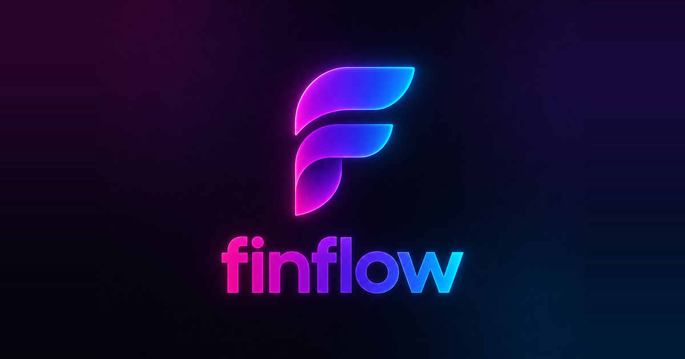
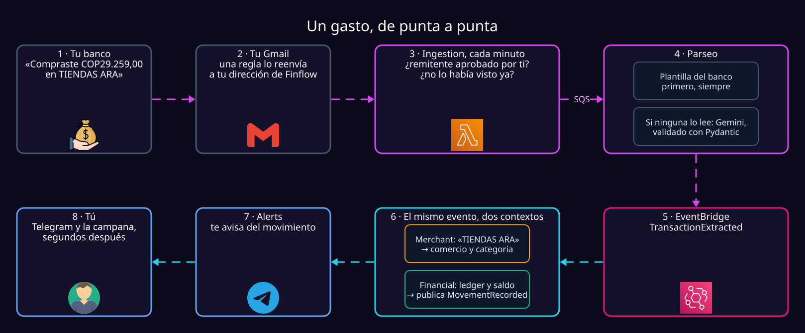

<div align="center">



### Tus finanzas personales, armadas solas con los correos que tu banco ya te manda.

<a href="#cómo-funciona"></a>

<br/>

[](#stack)
[](#stack)
[](#stack)
[](#arquitectura)
[](#arquitectura)
[](#stack)
[](#primero-lo-determinista-después-el-modelo)
[](#arrancarlo-en-local)

[](#los-cinco-contextos)
[](#arquitectura)
[](docs/frontend-integration.md#referencia-de-endpoints)
[](#calidad)

[**Cómo funciona**](#cómo-funciona) · [**Arquitectura**](#arquitectura) · [**Qué hace hoy**](#qué-hace-hoy) · [**Arrancarlo en local**](#arrancarlo-en-local) · [**Guías**](#guías)

</div>

---

> [!NOTE]
> **Un despliegue privado**, para el autor y un puñado de amigos, cada uno viendo
> solo sus propias finanzas. Es una **aplicación web** pensada para el navegador
> del teléfono —deliberadamente no una app nativa, así que no hay tienda de por
> medio— y vive en la capa gratuita de AWS. El aislamiento entre usuarios es
> estricto de todos modos.

## El problema

Las apps de finanzas personales se abandonan por lo mismo: **piden anotar cada
gasto a mano**, y nadie lo sostiene más de dos semanas. Mientras tanto, los
bancos colombianos ya mandan un correo por cada compra, transferencia o pago.

Finflow parte de ahí. Cada usuario **reenvía las alertas de su banco** a una
dirección propia, y el sistema extrae el movimiento, reconoce el comercio,
mueve el saldo de la cuenta correcta y mantiene el **patrimonio neto** al día.
Sin conectar cuentas bancarias, sin OAuth y **sin leer nunca el buzón personal
de nadie**: la única bandeja que Finflow abre es la suya.

## Cómo funciona

Una compra con tarjeta, de punta a punta:



Merchant y Financial escuchan **el mismo evento** y no se conocen entre sí: uno
decide quién es el comercio, el otro cuánto dinero se movió y de dónde.

<details>
<summary><b>¿Y si la alerta no es una compra normal?</b></summary>
<br/>

| La alerta dice… | Finflow… |
|:---|:---|
| «Pagaste la tarjeta *7653 desde la cuenta *5261» | Es un **traslado**: dos movimientos, uno por lado. No cuenta como gasto ni como ingreso. |
| «Aprobamos una compra…» (autorización, todavía no cobrada) | **La descarta a propósito**, para no contar el mismo gasto dos veces cuando llegue el cobro. |
| Algo que ni la plantilla ni el modelo pueden leer con exactitud | **Conserva el correo sin inventar nada**: un monto adivinado sería un saldo equivocado. |
| Una tarjeta que todavía no declaraste como cuenta | Guarda el movimiento **sin asignar**, y la cuenta lo adopta en cuanto la declares. |
| Un remitente que no aprobaste | Lo descarta, pero la pantalla de conexión te lo muestra para aprobarlo con un toque. |

</details>

## Arquitectura

Un backend **dirigido por eventos** sobre AWS serverless, y un frontend
estático. Cada tarjeta con borde naranja y λ es una función Lambda; cada cola
tiene su *dead-letter queue* con alarma.



<details>
<summary><b>Por qué así</b></summary>
<br/>

- **SQS para el trabajo, EventBridge entre contextos.** Una alerta es trabajo
  que se reintenta; un movimiento registrado es un hecho que a varios les
  interesa.
- **La entrega es at-least-once en todo el sistema.** La identidad de un correo
  sale del usuario más su `Message-ID`, la deduplicación es una escritura
  condicional en DynamoDB, y ningún contador se incrementa sin reclamar antes el
  `event_id` que lo provocó. Nada depende de memoria.
- **El dinero nunca es un `float`**: `Decimal` en el dominio y *string* en los
  eventos, porque un float JSON pierde centavos.
- **Ningún evento expone un agregado.** Solo llega a EventBridge lo que el
  traductor de cada contexto arma campo por campo.
- **La API es FastAPI tal cual**, detrás del Lambda Web Adapter: el mismo
  `uvicorn` que corre en local.

</details>

### Los cinco contextos

Cada contexto es dueño de su modelo y no importa agregados, repositorios ni
servicios de otro. Se hablan por eventos o por el caso de uso que el otro
publica, a través de un adaptador propio.

| Contexto | Es dueño de | Publica | Escucha |
|:---|:---|:---|:---|
| **Ingestion** | El buzón compartido, las direcciones de reenvío, el filtro de remitentes, la deduplicación, el parseo, el tope del modelo y los strikes | `TransactionExtracted` · `TransferExtracted` · `ModelReadingSuspended` | — |
| **Merchant** | Comercios canónicos, sus alias y su categoría | `MerchantIdentified` y compañía (hoy sin suscriptor) | `TransactionExtracted` |
| **Financial** | Cuentas, movimientos, saldos, deuda, patrimonio, facturas, plan y presupuestos | `MovementRecorded` · `AccountBalanceChanged` | `TransactionExtracted` · `TransferExtracted` |
| **Identity** | Usuarios, credenciales y autenticación; la bandeja, delegando en Ingestion | `UserRegistered` (hoy sin suscriptor) | — |
| **Alerts** | Canales de Telegram, la campana, el resumen del lunes y los avisos de cuenta | — | `MovementRecorded` · `ModelReadingSuspended` |

### Primero lo determinista, después el modelo

Una plantilla es barata, repetible y auditable; el modelo solo se consulta
cuando todas fallaron. **Bancolombia** y **Lulo** tienen plantilla propia. Lo
que devuelve Gemini pasa por un esquema Pydantic y después por los objetos de
valor del dominio: un monto ilegible o una fecha imposible es «no lo pude
leer», nunca una transacción.

El modelo cuesta, así que tiene límites:

- **20 lecturas por persona y por día.** La cifra se cambia sin desplegar.
- **Strikes contra el abuso.** Diez correos que no son de un banco en una hora
  pausan el modelo para esa persona: un día, luego tres, luego hasta que un
  operador lo reactive. Las plantillas nunca se suspenden.

Todo esto está en [overview.md → El tope del modelo](docs/overview.md#el-tope-del-modelo).

## Qué hace hoy

<details open>
<summary><b>💸 Movimientos que entran solos</b></summary>
<br/>

- Cada usuario reenvía las alertas de su banco a su propia dirección, y el
  sistema revisa el buzón cada minuto.
- **Las cuentas las declara el dueño, nunca se descubren solas.** Sin ninguna
  cuenta la app ya sirve: registra todo y lo deja sin asignar; al declarar una
  cuenta, adopta sus movimientos anteriores.
- **Cualquier movimiento se escribe, se corrige o se borra a mano**, y al
  borrarlo la cuenta recupera la plata.
- **Los traslados no son gasto.** Pagar la tarjeta desde una cuenta propia
  mueve los dos saldos. Si el banco lo reportó como gasto, se marca como
  traslado desde el mismo movimiento.

</details>

<details>
<summary><b>🏦 Créditos, inversiones y patrimonio</b></summary>
<br/>

- **Los créditos se cobran solos lo que el mes les cobra.** Con la tasa, el
  corte, la cuota y los seguros declarados, cada corte cerrado deja escritos
  los intereses y cada seguro como movimientos, con su tabla de amortización.
- **Un préstamo o una hipoteca se vigilan pero no se suman** al patrimonio;
  una tarjeta sí, porque lo que debe *es* el gasto del mes.
- **Las inversiones sí suman.** Un CDT acumula su rendimiento; un fondo se
  valora a mano y la diferencia queda como movimiento.

</details>

<details>
<summary><b>🏷️ Comercios y categorías</b></summary>
<br/>

- Cada grafía que usa un banco se agrupa bajo un comercio canónico, en cuatro
  niveles: la misma grafía, la misma raíz sin ruido, una submarca, y solo al
  final el modelo, que sabe que `BANCOLOMBIA NEQUI` y `NEQUI` son una empresa.
- Lo que proponen los dos últimos niveles queda **como sugerencia revisable**,
  y una corrección del usuario le gana a cualquier regla para siempre.
- Dieciséis categorías de serie, y las tuyas encima.

</details>

<details>
<summary><b>🧾 Facturas, disponible del mes y presupuestos</b></summary>
<br/>

- **Facturas.** Lo domiciliado se declara una vez y se proyecta en el
  calendario. Declararla no mueve ningún saldo; confirmarla escribe el
  movimiento, y pulsarlo dos veces sigue siendo un solo cobro.
- **Que se cobren solas**, factura por factura: una factura armada espera a que
  se cierre la ventana de conciliación, y si el banco ya avisó, el cobro queda
  pagado por ese movimiento sin escribir nada.
- **La app propone las que no declaraste**, con la evidencia a la vista, pero
  nunca declara ni cobra nada por su cuenta.
- **Cuánto queda para gastar.** Lo que esperas que entre, menos lo que quieres
  guardar, lo ya gastado y lo que las facturas todavía deben, con la resta
  completa a la vista.
- **Presupuestos** sobre todo el mes, una categoría o varias juntas: verde,
  ámbar y rojo. Informan, no bloquean.

</details>

<details>
<summary><b>📊 Reportes, avisos y exportación</b></summary>
<br/>

- **Reportes:** cuánto sumó un periodo contra el anterior, la gráfica apilada
  por categoría, comercio o cuenta, y el detalle de una categoría mes a mes.
- **Avisos por Telegram**, conectados con un toque desde el perfil. Cada canal
  se apaga por separado y admite un monto mínimo.
- **La campana:** todo aviso queda también en la app durante 30 días, con o sin
  Telegram.
- **El resumen del lunes:** la semana anterior comparada con tu propia semana
  normal.
- **Exportar a CSV o Excel**, con todos los filtros de la lista. Ninguna celda se
  vuelve fórmula aunque el banco escriba `=…`.

</details>

<details>
<summary><b>🔐 Cuenta y seguridad</b></summary>
<br/>

- Registrarse exige un código de seis dígitos enviado al correo; la contraseña
  olvidada se recupera con un enlace que dura 30 minutos, y cambiarla cierra
  todas las sesiones.
- Contraseñas con bcrypt y tokens JWT. Los secretos viven en SSM Parameter
  Store y **la app se niega a arrancar si falta uno**.
- El contenido de un correo y la salida del modelo se tratan como datos no
  confiables.
- **Un recurso de otro usuario responde `404`**, nunca «no tienes permiso».

</details>

## Stack

| Capa | Tecnología |
|:---|:---|
| **Backend** | Python 3.13 · FastAPI · Pydantic v2 · bcrypt · PyJWT |
| **Infraestructura** | AWS SAM · Lambda (siete funciones) · SQS · EventBridge · DynamoDB on-demand · SSM · CloudWatch + SNS |
| **Modelo** | Gemini, solo como plan B, con salida estructurada |
| **Frontend** | React 19 · TypeScript · TanStack Router y Query · Tailwind CSS 4 · Vite, publicado en Cloudflare Pages |
| **Contrato** | `docs/openapi.json`, generado desde los routers; de él salen los tipos TypeScript |
| **Herramientas** | uv · just · Ruff · Pyright · Biome · Vitest · Playwright · moto · DevContainer |

## Arrancarlo en local

Todo corre dentro del DevContainer, contra **moto**: AWS emulado en proceso, sin
Docker extra ni credenciales.

```bash
cp .env.example .env   # y edita dos valores
just up                # emulador, recursos, datos de prueba, la API y los workers
just web               # el frontend
```

| | |
|:---|:---|
| **API y Swagger** | http://localhost:8000/docs |
| **Frontend** | http://localhost:5173 |

En local los códigos de verificación se escriben en el log en vez de enviarse,
así que te registras sin buzón. Tampoco se lee el buzón de ingesta, que
comparten todos los entornos: el correo de un banco se simula con
`POST /ingestion/bank-notifications`. El detalle, y cómo correrlo contra AWS, está en
[running.md](docs/running.md).

## Del push a producción



GitHub Actions asume un rol de AWS por OIDC, así que **no hay llaves de AWS
guardadas en GitHub**. Backend y web salen siempre juntos. El detalle está en
[ci.md](docs/ci.md).

## Calidad

| | |
|:---|:---|
| **Operaciones de API** | 91, todas en el contrato OpenAPI |
| **Pruebas de Python** | 2689, unitarias y de integración contra moto |
| **Pruebas del frontend** | 592, con Vitest |
| **Suites en navegador** | 14 con Playwright contra la pila real, una de ellas recorre las 23 pantallas en teléfono y escritorio |
| **Revisión por cambio** | Una pasada de revisión de código, y otra de seguridad cuando toca dinero, autenticación o entrada no confiable |

<sub>Cifras medidas el 31 de octubre de 2026.</sub>

## Guías

Cada guía tiene un trabajo. Busca aquí la tuya y no leas las otras.

| Quiero… | Guía |
|---|---|
| Entender qué hace el sistema y por qué está partido así | [overview.md](docs/overview.md) |
| **Levantar la app en local** (backend, workers y frontend) | [running.md](docs/running.md#local) |
| **Correrla contra AWS** desde mi máquina, en development o producción | [running.md](docs/running.md) |
| **Desplegar el backend** a development o a producción | [deploy.md](docs/deploy.md#backend--development) |
| **Publicar el frontend** | [deploy.md](docs/deploy.md#frontend--cloudflare-pages) |
| Saber qué hace el pipeline en cada push | [ci.md](docs/ci.md) |
| **Integrar el frontend con la API**: endpoints, orden de llamadas, reglas | [frontend-integration.md](docs/frontend-integration.md) |
| Trabajar dentro del frontend (tipos, dev server, diagnóstico) | [frontend/README.md](frontend/README.md) |
| Saber cómo un usuario conecta su banco | [email-forwarding.md](docs/email-forwarding.md) |
| **Configurar o arreglar los avisos** por Telegram | [alerts.md](docs/alerts.md) |
| Entender o **cambiar el tope diario del modelo**, o reactivar a alguien suspendido por strikes | [overview.md](docs/overview.md#el-tope-del-modelo) · [deploy.md](docs/deploy.md#el-tope-diario-del-modelo) |
| Probar la API a mano | [docs/postman/](docs/postman/README.md) |
| Por qué algo está hecho así, y qué se descartó | [decisions.md](docs/decisions.md) |

La lista completa de lo que hay en `docs/`, con los comandos de los cuatro
caminos en corto, está en [docs/README.md](docs/README.md).

## El repositorio

```text
.
├── src/personal_finance/
│   ├── api/                 # La app FastAPI: monta los routers de cada contexto
│   ├── contexts/            # ingestion · merchant · financial · identity · alerts
│   │   └── <contexto>/      #   domain → application → infrastructure / presentation
│   └── shared/              # Lo mínimo común, sin reglas de negocio
├── frontend/                # React + Vite: pantallas, tipos generados y e2e
├── infra/                   # Plantilla SAM, configuración por entorno y políticas IAM
├── tests/                   # unit/ e integration/ (contra moto)
├── scripts/                 # Smoke, verificación de flujos, OpenAPI y CI
├── docs/                    # Estas guías, el contrato y las decisiones
└── justfile                 # Todas las tareas: just --list
```

---

<div align="center">
  
  <br/>
  <sub>Finflow · finanzas personales dirigidas por eventos, a partir de las alertas de los bancos colombianos</sub>
</div>
