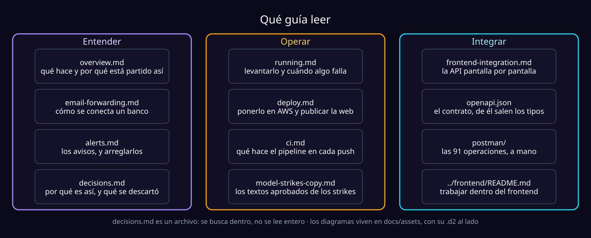

# Documentación de Finflow

Qué es Finflow, cómo funciona y qué hace hoy: el [README del proyecto](../README.md).
Aquí está cada guía con su trabajo. Busca la tuya y no leas las otras.



## Qué hay en esta carpeta

| Documento | Para qué |
| --- | --- |
| [overview.md](overview.md) | Qué hace el sistema, cómo entra un correo, los cinco contextos y el tope del modelo. Léelo primero. |
| [running.md](running.md) | Levantar y operar: local con moto, y desde tu máquina contra development o producción. Qué hacer cuando algo falla. |
| [deploy.md](deploy.md) | Dejarlo en AWS y publicar el frontend: permisos, secretos, aprovisionar, desplegar, comprobar. Los 18 parámetros del stack. |
| [ci.md](ci.md) | El pipeline: qué corre en cada push, cómo vuelve solo a la versión anterior y lo que se crea una vez. |
| [frontend-integration.md](frontend-integration.md) | El contrato de la API pantalla por pantalla, las reglas que la interfaz no puede romper y la referencia de endpoints. |
| [email-forwarding.md](email-forwarding.md) | Cómo un usuario conecta su banco: dirección de reenvío, remitentes aprobados y en qué paso va. |
| [alerts.md](alerts.md) | Los avisos: Telegram, la campana, el resumen del lunes y el aviso de suspensión. Configurarlos y arreglarlos. |
| [model-strikes-copy.md](model-strikes-copy.md) | Los textos aprobados de los correos y del banner cuando el modelo se suspende para alguien. |
| [decisions.md](decisions.md) | Por qué algo está hecho así y qué se descartó. Es un archivo: se busca dentro, no se lee entero. |
| [openapi.json](openapi.json) | El contrato de la API, generado desde los routers (`just openapi`). De aquí salen los tipos del frontend. |
| [postman/](postman/README.md) | La colección para probar la API a mano en Postman o Bruno. |
| [../frontend/README.md](../frontend/README.md) | Trabajar dentro del frontend: servidor de desarrollo, tipos, pruebas y diagnóstico. |

## Por tarea

| Quiero… | Guía |
| --- | --- |
| **Levantar la app en local** (backend, workers y frontend) | [running.md](running.md#local) |
| **Correrla contra AWS** desde mi máquina | [running.md](running.md) |
| **Desplegar el backend** | [deploy.md](deploy.md#backend--development) |
| **Publicar el frontend** | [deploy.md](deploy.md#frontend--cloudflare-pages) |
| **Integrar el frontend con la API** | [frontend-integration.md](frontend-integration.md) |
| **Configurar o arreglar los avisos** | [alerts.md](alerts.md) |
| Cambiar el tope diario del modelo, o reactivar a alguien suspendido | [overview.md](overview.md#el-tope-del-modelo) · [deploy.md](deploy.md#el-tope-diario-del-modelo) |

## Los cuatro caminos, en corto

**Local, todo en una terminal.** El emulador, los recursos, los datos demo, la
API y los workers (el lector del buzón queda apagado en local):

```bash
cp .env.example .env       # y edita dos valores
just up                    # API en http://localhost:8000
just web                   # frontend en http://localhost:5173
```

**Desplegar el backend.** Aprovisionar primero, desplegar después; el orden no
es negociable:

```bash
just provision-dev && just deploy-dev && just smoke <ApiUrl>     # development
just provision-prod && just deploy-prod && just smoke-prod <ApiUrl>
```

Una sola vez por entorno, antes del primer despliegue, el tope del modelo:
`just llm-limit-put development 20` (o `production`). Sin él, el despliegue
sale bien y los correos que necesitan el modelo terminan en la DLQ.

**Publicar el frontend.** Construye contra la `ApiUrl` del stack y sube:

```bash
just web-publish-dev       # o `just web-publish` para producción
```

Y después, una sola vez: el origen que imprime va a `CorsOrigins` en
`infra/samconfig.toml` y el backend se vuelve a desplegar.

**Integrar.** El contrato es `docs/openapi.json`, generado desde los routers;
de él salen los tipos TypeScript del frontend:

```bash
just web-types    # regenera el contrato y los tipos
just check-all    # las dos mitades
```

## Los diagramas

Viven en [`assets/`](assets/), cada `.svg` con su fuente `.d2` al lado, y se
escriben en [D2](https://d2lang.com) con el motor de layout ELK. Para cambiar
uno, edita el `.d2` y regenera:

```bash
d2 docs/assets/<nombre>.d2 docs/assets/<nombre>.svg
```

> [!IMPORTANT]
> Usa el `d2` de línea de comandos, que **mete los íconos dentro del SVG**. El
> export de [play.d2lang.com](https://play.d2lang.com) los deja como URLs, y
> GitHub no carga nada externo dentro de un SVG: las tarjetas saldrían sin
> ícono. Las flechas animadas sí funcionan en GitHub: son CSS dentro del
> archivo.

Un push que solo toca `docs/` no corre el pipeline ([ci.md](ci.md)): cambiar un
diagrama no despliega nada.

