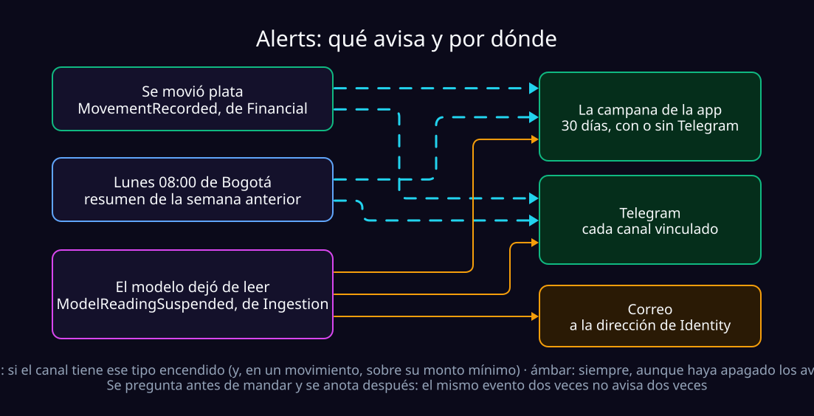
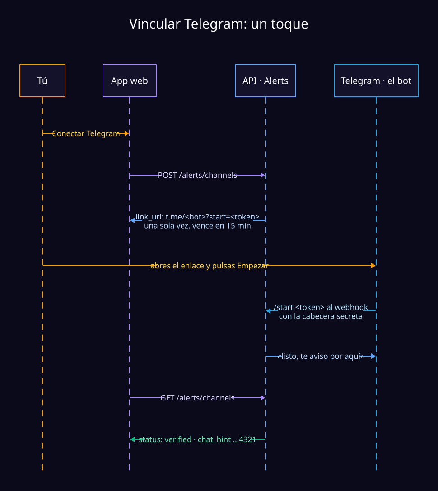

# Avisos: Telegram, la campana y el resumen del lunes

Qué hace el contexto `alerts`, cómo se configura y qué falla cuando no
funciona. Es lo que convierte a Finflow en algo que no hay que acordarse de
abrir: un mensaje al teléfono cada vez que se mueve plata.

> [!CAUTION]
> **Ojo con el nombre.** `just alerts-dev` / `alerts-prod` son otra cosa: quién
> recibe las alarmas de CloudWatch. Las recetas de estos avisos llevan
> `alerts-worker` y `telegram-*`.



## Qué recibe el usuario

Unas líneas en texto plano, segundos después de que el movimiento entra:

```text
Gasto $84.300
COMPRA EN *PAYU*COL
Bancolombia · 13/09 04:46 p. m.
Sin cuenta asignada

Mercado: te quedan $215.700 de $600.000
```

| | |
| :--- | :--- |
| **Dice lo que dice el banco** | La contraparte es el texto crudo del correo (`COMPRA EN *PAYU*COL`, no `PayU`) y no hay total del mes: el nombre bonito es de Merchant y el acumulado de Financial ([decisions.md](decisions.md)). |
| **Los presupuestos, solo si lo cubren** | Debajo va lo que queda de cada presupuesto que cubre la compra (hasta tres, y «y N más»), o cuánto lo pasaste. Si ninguno la cubre, no dice nada más. |
| **Todo lo que el ledger registra** | Del banco o escrito a mano, gastos e ingresos. **No los devengos**: los intereses y seguros que la app calcula llegan de a cuatro mientras su dueño mira la pantalla del crédito. |
| **Un traslado avisa una vez** | Son dos filas y una sola plata: avisadas por separado, pagar la tarjeta desde ahorros llegaba como «Gasto · Visa Platinum» y como «Ingreso · Cuenta de ahorros». Ahora llega «Traslado entre cuentas» con `De:` y `A:`; Financial marca el otro lado `quiet` y nunca se avisa. La cuota de un crédito sigue siendo «Gasto», pero también dice de dónde salió y a dónde fue. Marcar después un gasto como traslado no manda nada nuevo: ese gasto ya se avisó. |
| **Cada canal se apaga aparte** | Y admite un **monto mínimo**: es contra el ruido, no contra el dinero. Un café no debe gastar la atención de un cargo de $400.000. |

### La campana

Todo aviso que se mandó, o se habría mandado, a Telegram queda **30 días** en
la app, **tenga o no el usuario un canal** (`GET /alerts/inbox`). La pantalla
la consulta cada pocos segundos mientras está visible y enseña lo nuevo como
una notificación flotante: lo más cercano a tiempo real sin sockets. Ocultar
un aviso (`DELETE /alerts/inbox/{id}`) es para siempre y no borra el de
Telegram.

### El resumen del lunes

Los lunes a las **08:00 de Bogotá**, `WeeklySummaryFunction` manda lo gastado
la semana anterior (de lunes a domingo, por moneda) contra **lo normal de tus
propias semanas**, y la categoría que más subió. La primera semana no hay con
qué comparar, y el mensaje lo dice en vez de comparar contra cero.

- Es el tipo `weekly_summary`, encendido por defecto; se apaga con el mismo
  `PATCH /alerts/channels/{id}` que los movimientos.
- Correrlo dos veces la misma semana no manda nada dos veces, y un usuario con
  datos raros no frena a los demás.
- Solo conoce a quien ya tuvo algún movimiento: Alerts arma su lista con lo que
  oye, sin preguntar a otro contexto quién existe.

```bash
just weekly-summary              # la semana anterior a hoy
just weekly-summary 2026-09-21   # la semana que contiene ese día
```

Una semana que no ha terminado se rechaza: su resumen ocuparía el lugar del de
la semana completa.

### Cuando el modelo deja de leer sus correos

Con un strike ([overview.md](overview.md#los-strikes)), Ingestion publica
`ModelReadingSuspended` y Alerts avisa por los tres lados del diagrama: la
campana (`model_paused`), **cada Telegram vinculado aunque haya apagado los
avisos** —no es algo que pidió, es algo que le pasó a su cuenta— y **su
correo**, con el texto de [model-strikes-copy.md](model-strikes-copy.md).

El correo es el único mensaje que no va por Telegram, porque quien nunca lo
vinculó también tiene que enterarse. La dirección la da Identity por su caso de
uso publicado, y sale de la misma casilla que manda los códigos de
verificación (`MailFromAddress` y `MailAppPasswordParameter`). Si el correo o
Telegram están caídos, el mensaje vuelve a la cola y el reintento solo completa
lo que faltó. En local no hay servidor de correo: se escribe en el log.

## Cómo se vincula



| Regla | Por qué |
| :--- | :--- |
| **El token sirve una vez y vence en 15 minutos** | Solo viaja en la respuesta de `POST /alerts/channels`; se guarda su hash y `GET /alerts/channels` no lo devuelve. Pedir otro retira el anterior: nunca hay dos enlaces vivos. |
| **Un chat pertenece a una sola cuenta** | Dos personas recibiendo sus movimientos en la misma conversación es una fuga que ninguna aceptó. El bot lo dice ahí mismo. |
| **Un grupo no vincula nunca** | Solo chats privados. |
| **La pantalla nunca muestra el chat entero** | Solo los últimos cuatro (`…6789`): todo lo que su dueño necesita para reconocerlo. |

## Configurarlo

| Paso | Qué | Dónde |
| :--- | :--- | :--- |
| **1. El bot** | Con [@BotFather](https://t.me/BotFather): `/newbot`, un nombre y un usuario terminado en `bot`. Da un token `1234567890:AA...`. **Uno por entorno**: un solo bot no podría decir de cuál viene un aviso. | Telegram |
| **2. El secreto del webhook** | Lo inventas tú, y es lo único que autentica el webhook: `uv run python -c "import secrets; print(secrets.token_hex(32))"` | Tu terminal |
| **3. En local** | Los tres valores en `.env`, en texto. | `.env` |
| **4. Desplegado** | Los dos secretos en SSM y los tres overrides en `samconfig.toml`. | AWS |
| **5. El webhook** | Registrarlo, una vez por entorno, después de desplegar. | `just telegram-webhook-*` |

### En local

```dotenv
ALERTS_TELEGRAM_BOT_TOKEN=1234567890:AA...
ALERTS_TELEGRAM_BOT_USERNAME=mi_bot
ALERTS_TELEGRAM_WEBHOOK_SECRET=el-que-acabas-de-generar
```

- **Sin token, el worker escribe el mensaje en el log** en vez de mandarlo: ves
  el texto exacto sin gastar un bot. Esa rama la decide `ENVIRONMENT=local` y
  nada más; un interruptor propio sería uno que alguien puede activar en
  producción.
- **El secreto del webhook hace falta siempre.** Vacío, la comparación en
  tiempo constante aceptaría una cabecera vacía. Cuando falta, el endpoint
  rechaza a todo el mundo.

### Desplegado

```bash
just secret-put /finflow/development/telegram-bot-token
just secret-put /finflow/development/telegram-webhook-secret
```

Y en `parameter_overrides` de `infra/samconfig.toml`:

```toml
"TelegramBotUsername=mi_bot_dev",
"TelegramBotTokenParameter=/finflow/development/telegram-bot-token",
"TelegramWebhookSecretParameter=/finflow/development/telegram-webhook-secret",
```

> [!WARNING]
> **Estos tres overrides no son opcionales.** `infra/template.yaml` los declara
> con un default que apunta a `/finflow/production/`: olvidarlos no deja el
> stack sin secreto, lo hace leer el del otro entorno
> ([deploy.md](deploy.md#4-los-secretos-en-parameter-store)).

### Registrar el webhook

Telegram no sabe a dónde entregar hasta que se lo dices, y la URL solo cambia
con el Function URL:

```bash
just deploy-outputs-dev     # de aquí sale ApiUrl
just telegram-webhook-dev https://<ApiUrl>/alerts/telegram/webhook
just telegram-webhook-info-dev
```

No es parte del despliegue a propósito: dos stacks registrándose contra el
mismo bot se pelearían, y el que perdiera dejaría de recibir en silencio.

## Probarlo en local

Telegram no alcanza `localhost`, así que la mitad de entrada se suplanta —para
eso es la cabecera secreta— y todo lo demás es real:

```bash
just up                        # emulador, datos, la API y los cuatro workers de cola

# 1. POST /alerts/channels  →  copia el token del link_url
just telegram-update <token>   # hace de Telegram: /start <token> al webhook

# 2. GET /alerts/channels  →  status "verified", chat_hint "…4321"
# 3. registra un movimiento (POST /financial/transactions)
# 4. el mensaje aparece en el stream `alerts` de `just up`
```

`--chat-type group` y `--secret <otro>` comprueban los dos rechazos: un grupo
no vincula, y una cabecera equivocada es un `403`.

## Cuando no funciona

| Síntoma | Causa casi siempre |
| :--- | :--- |
| `ParameterNotFound … /finflow/production/telegram-bot-token` al arrancar dev | Faltan los overrides en `samconfig.toml` |
| `503` en `POST /alerts/channels` | Ese despliegue no tiene bot. El resto de la app funciona |
| Abre el bot, pulsas Empezar y no pasa nada | El webhook no está registrado (`just telegram-webhook-info-<entorno>`) |
| `403` en el webhook | La cabecera no coincide con `ALERTS_TELEGRAM_WEBHOOK_SECRET`, o no hay secreto |
| Vincula pero no llega el «listo» | El bot no puede escribir a ese chat; los avisos fallarán igual |
| «Este Telegram ya está conectado a otra cuenta» | Literal: desvincúlalo en la otra primero |
| Los avisos llegan repetidos | `AlertsFunction` debe seguir con `ReservedConcurrentExecutions: 1` |
| Nada llega y la cola crece | La alarma `<stack>-alerts-events-dead-letters` debería estar avisando |

```bash
just deploy-logs-dev AlertsFunction    # /finflow/<stack>/alerts
```

**El mensaje no está en los logs**: se registra el id del canal y un código de
estado; el texto lleva el monto y la contraparte de alguien.

## Dos decisiones que sorprenden al leer el código

| | Por qué |
| :--- | :--- |
| **La marca de entrega se escribe *después* de mandar** | Al revés que el `ProcessedEventStore` de Merchant. Marcar antes, una caída entre marca y envío es **una compra de la que nadie se enteró**; marcar después, es **un mensaje repetido**. Lo segundo es molesto; lo primero, justo lo que este contexto existe para evitar. |
| **Una sola ejecución a la vez** | Lo anterior solo aguanta reentregas *secuenciales*: dos workers a la vez leerían «no entregado» y mandarían los dos. A este volumen serializar no cuesta nada: `ReservedConcurrentExecutions: 1`. |

## Qué falta

- **Una sola hora para todos.** No hay zona horaria por usuario: el
  `13/09 04:46 p. m.` sale de `ALERTS_DISPLAY_TIMEZONE` (Bogotá). Deja de
  servir el día que alguien lo use desde otro huso.
- **Tres mensajes**: el movimiento (con sus presupuestos), el resumen del lunes
  y el aviso de cuenta. Un aviso propio de cobro recurrente se enchufa sin
  migrar nada: una preferencia que nadie expresó toma el valor por defecto que
  declara su tipo.
- **Un solo transporte.** El puerto `MessageSender` no sabe qué es Telegram: un
  segundo canal es un adaptador más, sin cambios de dominio.
