# Despliegue automático

Cada push a **`master`** despliega **producción** y cada push a **`dev`**
despliega **desarrollo**, solo si antes pasa todo lo que prueba que lo viejo
sigue funcionando. Es `.github/workflows/pipeline.yml`, y corre las mismas
recetas de `just` que se corren a mano: el pipeline no tiene un camino propio.



## Los tres trabajos

| Trabajo | Qué hace | Si falla |
| :--- | :--- | :--- |
| **Validaciones** | `just check-all` (formato, lint, tipos, pruebas unitarias y de integración, el contrato de la API y el frontend con sus pruebas) y `just infra-check` (la plantilla es desplegable en los dos entornos) | Nada llega a AWS |
| **Flujos y pantallas** · solo `master` | Levanta la pila local entera en el runner (moto, datos, API, workers y Vite) y corre `just verify` —dos usuarios de punta a punta, con integridad y aislamiento— y `just e2e`, que incluye `e2e-views`: todas las pantallas en teléfono y escritorio | Nada llega a AWS; los logs quedan como artefacto |
| **Desplegar y comprobar** | Despliega backend y web, corre el smoke contra lo desplegado (`smoke-prod`, que solo lee, en producción; `smoke` en desarrollo) y limpia las imágenes viejas de ECR | Vuelve sola a la versión anterior y la ejecución termina en rojo |

Los dos primeros corren **antes** de tocar AWS y contra el emulador: prueban el
código nuevo. El smoke prueba la API desplegada, así que va después, con la
reversión como red.

| Regla | Por qué |
| :--- | :--- |
| **Backend y web salen siempre juntos** | Una web publicada contra una API que aún no existe rompe la pantalla (pasó el 2026-09-01). |
| **Nunca dos a la vez en la misma rama, y nunca se cancelan a mitad** | Un despliegue cortado entre el backend y la web los deja desacompasados. |
| **Las e2e corren después del merge, no en el PR** | Ahorra minutos de GitHub. Si un PR rompe un flujo, producción no se toca, pero `master` queda con el error hasta el arreglo. Llevarlas al PR es cambiar la condición del trabajo `e2e`. |
| **Un push que solo toca texto no corre nada** | Ningún `.md` ni nada en `docs/` lo prueba ni lo despliega, con una excepción: `docs/openapi.json`, que es el contrato. Un push que mezcla texto y código corre entero. |
| **Un PR corre siempre**, aunque solo traiga texto | Es la validación que espera la protección de `master`, y una que no corre nunca responde. *Run workflow* también corre siempre. |

## Cómo sabe a qué volver


- **La reversión usa el mismo script** (`scripts/ci/deploy.sh <entorno>
  ../previous`): no es un camino aparte que solo se ejercita el peor día.
- **La primera vez no hay etiqueta**, así que no hay a qué volver: un fallo
  solo deja la ejecución en rojo.
- **Aprovisionar no se revierte**, a propósito: crea o ajusta tablas y colas,
  nunca borra, y la versión anterior ignora lo que no conoce.

## Lo que hay que crear una vez

Todo en la cuenta `792884702854` y el repositorio `lStiven/finflow`.

| | Qué | Para qué |
| :--- | :--- | :--- |
| **1** | El proveedor OIDC de GitHub en AWS | GitHub pide credenciales temporales: **ninguna llave de AWS guardada en GitHub** |
| **2** | Un rol de AWS por entorno | Cada rol solo lo asume **su** entorno y **su** rama |
| **3** | Dos entornos en GitHub, con variables y secretos | Qué rol, qué cuenta de Cloudflare y qué `.env` usa cada uno |
| **4** | Recomendado: proteger `master` | PR obligatorio y la validación en verde |

### 1. El proveedor OIDC

Una sola vez por cuenta:

```bash
aws iam create-open-id-connect-provider \
  --url https://token.actions.githubusercontent.com \
  --client-id-list sts.amazonaws.com
```

### 2. Un rol por entorno

Desarrollo y producción viven en la misma cuenta (ver Trabas en
`PROGRESS.md`), así que lo único que separa un push a `dev` de producción es
que cada rol solo lo puede asumir su entorno de GitHub. Las políticas de
confianza ya están escritas: `infra/iam/github-oidc-trust-production.json` y
`...-development.json`.

```bash
aws iam create-role --role-name finflow-deploy-github-production \
  --assume-role-policy-document file://infra/iam/github-oidc-trust-production.json
aws iam create-role --role-name finflow-deploy-github-development \
  --assume-role-policy-document file://infra/iam/github-oidc-trust-development.json
```

- **El `sub` lleva los ids numéricos** de la cuenta y del repo
  (`lStiven@25795990/finflow@1342916879`): si el repo se renombra o se recrea,
  el número cambia y AWS deja de confiar.
- **Cada política exige el entorno de GitHub *y* la rama** (`master` o `dev`):
  la misma cerradura del lado de AWS, por si la regla de GitHub cambia un día.
- **Permisos**: los mismos que tiene el usuario con el que despliegas ese
  entorno a mano, y además `FinflowDeployPublicImages`
  (`infra/iam/finflow-deploy-public-images-policy.json`), el login en ECR
  Public para no depender del cupo anónimo de la IP del runner. Va aparte
  porque `FinflowDeploy` ya está en el tope de tamaño de una política.

> [!WARNING]
> `infra/iam/finflow-deploy-policy.json` es la referencia, pero el 2026-09-15
> se comprobó que no es un espejo de lo adjunto. Copia las políticas del
> usuario real: es lo que evita descubrir un permiso faltante a mitad del
> primer despliegue.

### 3. Dos entornos en GitHub

En *Settings → Environments*, `production` y `development`:

| | `production` | `development` |
| :--- | :--- | :--- |
| **Deployment branches** | solo `master` | solo `dev` |
| **Variable `AWS_ROLE_ARN`** | el ARN de su rol | el ARN de su rol |
| **Variable `CLOUDFLARE_ACCOUNT_ID`** | `npx wrangler whoami` lo muestra | igual |
| **Secret `ENV_FILE`** | el contenido de `.env.production`, incluida `AWS_PROFILE` (el pipeline crea un perfil con ese nombre) | el de `.env.development` |
| **Secret `CLOUDFLARE_API_TOKEN`** | permiso *Cloudflare Pages: Edit* | igual |

### 4. Proteger `master`

*Settings → Rules → Rulesets* (o *Branches*): exigir un PR, que pase
**Validaciones (check-all)** y que la rama esté al día. **Solo esa**: *Flujos y
pantallas* no corre en los PR, y exigirla dejaría todo PR esperando para
siempre.

## Probarlo sin esperar un push

*Actions → Validar y desplegar → Run workflow*, eligiendo la rama. En local, lo
mismo que corre el trabajo de flujos:

```bash
scripts/ci/local-stack.sh start
just verify && just e2e
scripts/ci/local-stack.sh stop
```

Sin `.env`, el script arma uno con `scripts/ci/local-env.sh`: el ejemplo más
las dos claves que deja vacías a propósito (el secreto de los tokens, que se
genera en cada corrida, y una dirección de buzón que nadie lee).

## Lo que sigue siendo a mano

- **El webhook de Telegram y sus secretos en SSM**, una vez por entorno
  ([alerts.md](alerts.md#configurarlo)).
- **El tope del modelo en SSM**, una vez por entorno y **antes** del primer
  push que lo incluye: `just llm-limit-put development 20` antes de empujar a
  `dev`, y `just llm-limit-put production 20` antes de mezclar a `master`.

  > [!CAUTION]
  > El pipeline no puede detectar que falta: despliegue y smoke salen en verde,
  > y el primer correo que necesite el modelo acaba en la DLQ
  > ([deploy.md](deploy.md#el-tope-diario-del-modelo)).

- **Cualquier parámetro nuevo de SSM**: el pipeline despliega rutas, nunca
  crea valores.
- **Borrar recursos que ya no se usan**, como el índice viejo `by_user` de la
  tabla de notificaciones.
