# Desplegar Finflow

Dejar el sistema corriendo en AWS y el frontend publicado. Para arrancarlo
desde tu máquina —en local, o contra una cuenta real— ver
[running.md](running.md). Lo que hace el pipeline solo en cada push está en
[ci.md](ci.md).



| Quiero | Ir a |
| :--- | :--- |
| Preparar la máquina y la cuenta, una sola vez | [Antes de la primera vez](#antes-de-la-primera-vez) |
| Desplegar el backend a development | [Backend → development](#backend--development) |
| Desplegar el backend a producción | [Backend → producción](#backend--producción) |
| Publicar el frontend | [Frontend → Cloudflare Pages](#frontend--cloudflare-pages) |
| Saber si lo desplegado funciona | [Comprobar que sirve](#comprobar-que-sirve) |

## Antes de la primera vez

Seis cosas, una vez por máquina o por cuenta:

| | Qué | Cómo |
| :--- | :--- | :--- |
| **1** | Docker y el SAM CLI | `docker info` y `sam --version`; los deja el DevContainer |
| **2** | Los perfiles de AWS | `aws configure --profile finflow-dev` y `finflow-production` |
| **3** | Los permisos del usuario que despliega | La política `FinflowDeploy` |
| **4** | Los secretos | `just secret-put /finflow/<entorno>/…` |
| **5** | La cuenta de correo de ingesta | Una Gmail con App Password por entorno |
| **6** | Cloudflare | `cd frontend && npx wrangler login` |

### 1. Docker y el SAM CLI

```bash
docker info      # el DevContainer usa el daemon del host
sam --version    # lo instala postCreateCommand con `uv tool install aws-sam-cli`
```

<details>
<summary><b><code>sam build</code> muere con <code>docker-credential-dev-containers-… exited with ""</code></b></summary>
<br/>

No es Docker ni AWS. La extensión Dev Containers escribe
`credsStore: dev-containers-<uuid>` en `~/.docker/config.json`, y ese ayudante
no implementa `list`, justo lo que el SDK de Docker llama antes de construir.
`docker build` a mano no pasa por ahí, por eso funciona y `sam build` no.

`just deploy-dev` y `just deploy-prod` ya lo esquivan con `DOCKER_CONFIG`
apuntando a una configuración sin ayudante (las imágenes base son públicas). A
mano:

```bash
DOCKER_CONFIG=.aws-sam/docker-config sam build --config-env production \
    --config-file infra/samconfig.toml --template infra/template.yaml
```

</details>

> [!TIP]
> **«No changes to deploy» no es un fallo.** La imagen solo lleva
> `pyproject.toml`, `uv.lock` y `src/personal_finance`: una rama que toca el
> frontend, la documentación o el `justfile` construye una imagen idéntica, y
> `fail_on_empty_changeset = false` hace que eso termine en éxito. Para
> comprobarlo, el id de la imagen va dentro de la etiqueta
> (`apifunction-<id>-api`):
>
> ```bash
> docker images --format '{{.Repository}} {{.ID}}' | grep function
> aws lambda get-function --function-name <nombre> --profile finflow-production \
>     --query 'Code.ImageUri' --output text
> ```

### 2. Los perfiles de AWS

```bash
aws configure --profile finflow-dev
aws configure --profile finflow-production
```

`~/.aws` vive en un volumen Docker con nombre (`finflow-v2-aws`): **sobrevive a
un rebuild**, y el contenedor no ve ninguna otra credencial tuya. Para empezar
de cero, `docker volume rm finflow-v2-aws` y reconstruye. Con IAM Identity
Center, `aws configure sso`: se guarda un token que caduca, no una clave.

### 3. Los permisos del usuario que despliega

`sam deploy` crea el stack, sube la imagen y crea los roles de ejecución: un
usuario de plano de datos falla con `AccessDenied` a mitad y deja el stack en
`ROLLBACK`. `infra/iam/finflow-deploy-policy.json` es la política mínima,
acotada por prefijo (stacks `finflow` y `finflow-dev`, roles y funciones
`finflow-*`, logs y parámetros `/finflow/*`), con `iam:PassRole` limitado a
`lambda.amazonaws.com`.

```bash
aws iam create-policy --policy-name FinflowDeploy \
  --policy-document file://infra/iam/finflow-deploy-policy.json
aws iam attach-user-policy --user-name <tu-usuario> \
  --policy-arn arn:aws:iam::<cuenta>:policy/FinflowDeploy

# si ya existe y el archivo cambió: una versión nueva (IAM guarda cinco)
aws iam create-policy-version \
  --policy-arn arn:aws:iam::<cuenta>:policy/FinflowDeploy \
  --policy-document file://infra/iam/finflow-deploy-policy.json \
  --set-as-default
```

> [!WARNING]
> **Es la política de referencia, no un espejo de la cuenta.** El 2026-09-15 se
> comprobó que los dos usuarios tienen permisos que no están aquí y que
> producción no tiene alguno que sí. Ninguno puede leer IAM sobre sí mismo: lo
> adjunto se mira en la consola. Un permiso que falta solo aparece cuando
> CloudFormation llama a esa API a mitad del despliegue (pasó con
> `lambda:PutFunctionConcurrency`, al crear la primera función nueva que lo
> usaba).

Dos sitios quedan en `*` y no por pereza: los repositorios de ECR los nombra el
*companion stack* de SAM con un hash, y los *event source mappings* se
identifican por UUID.

### 4. Los secretos, en Parameter Store



Uno por entorno. El valor se pide por prompt, nunca como argumento: una línea de
comandos se ve en `ps` y queda en el historial.

```bash
uv run python -c "import secrets; print(secrets.token_hex(32))"   # para el JWT y el webhook

just secret-put /finflow/production/jwt-secret
just secret-put /finflow/production/mailbox-app-password
just secret-put /finflow/production/mail-app-password
just secret-put /finflow/production/llm-api-key
just secret-put /finflow/production/telegram-bot-token
just secret-put /finflow/production/telegram-webhook-secret
```

| Secreto | Qué es |
| :--- | :--- |
| `jwt-secret` | Firma los tokens de sesión. |
| `mailbox-app-password` | La App Password del buzón de ingesta (IMAP). |
| `mail-app-password` | De dónde **salen** los correos de Identity (códigos, recuperar contraseña) y el aviso de suspensión. Puede ser la misma App Password que la anterior: son dos permisos distintos, y nada obliga a que la cuenta que envía sea la que recibe. |
| `llm-api-key` | La llave de Gemini. |
| `telegram-bot-token`, `telegram-webhook-secret` | Los avisos ([alerts.md](alerts.md#desplegado)). El del webhook lo inventas tú. |

- **El `.env` se deduce de la ruta**: no hay un segundo argumento que
  equivocar, y una ruta que contradiga el fichero se rechaza antes de pedir el
  valor. Cada comando imprime la línea para el `.env`, por ejemplo
  `IDENTITY_JWT_SECRET=ssm:/finflow/production/jwt-secret`.
- **Rotar es el mismo comando**, pero no se propaga solo: el valor se lee una
  vez por proceso. Hay que volver a desplegar o reiniciar el proceso local.
- La receta es `secret-put` **seguida de la ruta**: `just /finflow/...` a secas
  no es un comando.

> [!CAUTION]
> **Un override olvidado no falla: cruza los entornos.** Cada ruta se declara en
> `infra/template.yaml` con un *default* en `/finflow/production/`. El 14 de
> septiembre `finflow-dev` arrancó pidiendo
> `/finflow/production/telegram-bot-token`, no existía, y **la API entera no
> arrancó**; si hubiera existido, dev habría mandado avisos con el bot de
> producción sin que nada fallara. Un parámetro nuevo va en los **dos** bloques
> `parameter_overrides`, en el mismo cambio.

Identity necesita además dos valores que **no** son secretos:

| Parámetro | Qué es |
| :--- | :--- |
| `MailFromAddress` | La cuenta desde la que sale el correo. Tiene que ser la de la App Password de `MailAppPasswordParameter`. |
| `PasswordResetUrl` | La página del frontend que recibe el enlace (la API le añade `?token=…`). Tiene que ser `https`. |

**Esos tres son obligatorios**: sin ellos la API no arranca, porque un
despliegue que no puede mandar un código es uno donde nadie puede registrarse,
y eso tiene que fallar al desplegar y no ante el primer usuario. **Los de
Telegram no lo son**: sin bot, todo funciona y `/alerts/*` responde `503`; solo
el worker de avisos se niega a arrancar.

Comprueba la pareja antes de desplegar, que es cuando sale barato:

```bash
just mail-check "" .env.production   # un 535 = App Password y MailFromAddress de cuentas distintas
```

> [!NOTE]
> Hoy `finflow-dev` y `finflow-production` resuelven a la **misma cuenta de
> AWS**, con usuarios IAM distintos. Compruébalo antes de fiarte:
> `aws sts get-caller-identity --profile finflow-production --query '[Account,Arn]' --output text`

#### El tope diario del modelo

Cuántos correos lee el modelo por persona y día. No es secreto, pero vive en
SSM porque el parseo lo relee cada cinco minutos: **cambiarlo no exige
desplegar** ([cómo cuenta](overview.md#el-tope-del-modelo)).

```bash
just llm-limit-put development 20   # una vez por entorno, antes del primer despliegue que lo incluye
just llm-limit-put production 20
just llm-limit-put production 0     # apaga el modelo para todos; las plantillas siguen

aws ssm get-parameter --name /finflow/production/llm-daily-calls-per-user \
    --profile finflow-production --query Parameter.Value --output text
```

> [!CAUTION]
> **Sin él, el despliegue y el smoke salen en verde**, porque ninguno llama al
> modelo. El fallo aparece con el primer correo que ninguna plantilla reconoce:
> se reintenta y acaba en `parse-notifications-dlq`, con `Could not read the
> parameter at '/finflow/<entorno>/llm-daily-calls-per-user'` en el log. Crearlo
> arregla lo que llegue después; lo que ya está en la DLQ no vuelve solo.

La receta solo acepta un entero y escribe un `String` estándar, cuyas lecturas
no se cobran. `LlmDailyCallsParameter` tiene la misma trampa del *default* que
los secretos, y ya está en los dos bloques.

### 5. La cuenta de correo de ingesta

Manual y **una por entorno**: una Gmail dedicada, verificación en dos pasos y
una App Password ([por qué una por entorno](#cada-stack-tiene-su-propio-buzón)).
Los pasos están en
[running.md → Configurar la cuenta de ingesta](running.md#4-configurar-la-cuenta-de-ingesta).

### 6. Cloudflare, para el frontend

```bash
cd frontend && npx wrangler login
```

## Backend → development

```bash
cp .env.development.example .env.development   # solo la primera vez
aws sso login --profile finflow-dev            # si usas SSO

just provision-dev          # tablas, colas, DLQ, bus y reglas, todo `dev-`
# pega en .env.development las cinco URLs de cola que imprime

just deploy-dev             # construye la imagen y despliega las siete funciones
just deploy-outputs-dev     # la ApiUrl y lo demás que publica el stack
just smoke <ApiUrl>         # comprueba que responde de verdad
```

| Cuándo | Qué |
| :--- | :--- |
| Cambió una tabla o una cola | `provision-dev`. Repetirlo no hace daño: crea o ajusta, nunca borra. El pipeline lo corre en cada despliegue. |
| Cambió el código | `deploy-dev`. |
| Primera vez con el tope del modelo | `just llm-limit-put development 20`, antes de desplegar. |

Las cinco URLs de cola no se escriben por adelantado: llevan el id de cuenta y
solo existen una vez creada la cola.

> [!IMPORTANT]
> **Desde los strikes del modelo (2026-10-31) hay que aprovisionar antes de
> desplegar a mano**: la tabla `users` tiene un índice nuevo, `by_user_id` (con
> él Alerts sabe a qué correo escribir), y la regla de `alerts-events` deja
> pasar `ModelReadingSuspended`. Sin eso todo funciona hasta el primer strike,
> y entonces el aviso termina en `alerts-events-dlq`.

## Backend → producción

Idéntico, con las recetas `-prod` y una comprobación de solo lectura:

```bash
cp .env.production.example .env.production     # solo la primera vez
aws sso login --profile finflow-production

just provision-prod
# pega en .env.production las cinco URLs de cola que imprime
just llm-limit-put production 20   # solo la primera vez

just deploy-prod
just deploy-outputs-prod
just smoke-prod <ApiUrl>
```

La `ApiUrl` (`https://abc123.lambda-url.us-east-1.on.aws/`) **es la dirección
de la app**: HTTPS resuelto, sin dominio, certificado ni balanceador.

### Cada stack tiene su propio buzón

El prefijo `dev-` separa tablas, colas y bus, **no un buzón de Gmail**: eso lo
hace tener uno por entorno, y es lo que deja a los dos stacks leer a la vez
(`IngestScheduleState=ENABLED` en ambos).

El lector toma los correos `UNSEEN` y los marca `\Seen`, así que dos lectores
sobre **un mismo** buzón no duplican un mensaje, **se lo disputan**: cada correo
cae en el que preguntó primero. Antes de apuntar dos stacks a una sola cuenta,
apaga uno.

| Tiene que concordar | Con |
| :--- | :--- |
| `IngestMailboxAddress` en `samconfig.toml` | La App Password en la ruta de `MailboxPasswordParameter`. Son una credencial partida en dos, y solo IMAP se entera si no concuerdan. |

> [!WARNING]
> **Cambiar la cuenta de correo de un entorno son dos cosas**: la App Password
> nueva con `just secret-put`, y la dirección en `IngestMailboxAddress` (de ella
> sale la parte antes del `+` de cada dirección de reenvío) más el despliegue.
> Con usuarios ya registrados, invalida la dirección que cada uno pegó en Gmail.

## Frontend → Cloudflare Pages

```bash
just web-publish-dev        # contra el stack finflow-dev
just web-publish            # contra producción
```

Cada uno lee la `ApiUrl` del stack, **genera** `frontend/.env.production` con
ella, construye y sube `dist/`. No escribas ese fichero a mano: es el valor que
se queda viejo y produce una app que carga bien y llama a la URL de ayer. El
bundle no vive en AWS: S3 + CloudFront se retiró el 2026-09-01 porque la cuenta
no puede crear una distribución sin que la verifique Support
([decisions.md](decisions.md), «Deployment»).

> [!IMPORTANT]
> **Un despliegue que cambia el contrato arrastra una publicación**, en el
> mismo rato. Cuando `POST /identity/register` empezó a exigir
> `verification_token`, la API de development lo pidió a las 21:03 y el sitio
> siguió mandando email y contraseña a secas: registrarse respondía `422`
> aunque las dos mitades estuvieran bien.

**La primera vez, y cada vez que cambie el dominio**, el paso que no hace el
comando:

1. Copia el origen que imprime, en la línea `published at`.
2. Añádelo a `CorsOrigins` en `infra/samconfig.toml`, en su entorno.
3. Vuelve a desplegar el backend.

Sin eso **la app carga entera y ninguna llamada funciona**: el navegador las
bloquea en el preflight. La receta avisa si no encuentra el origen en
`samconfig.toml`.

| Trampa | Por qué |
| :--- | :--- |
| **No deduzcas el origen del nombre del proyecto** | Los `*.pages.dev` son únicos en todo Cloudflare: `finflow-dev` se publica en `finflow-dev-2tc.pages.dev`, y `finflow-dev.pages.dev` es de un desconocido. La receta lee el origen de lo que acaba de publicar. |
| **La rama de producción del proyecto es `master`** | Tiene que coincidir con `pages_branch` del `justfile`. Si no, cada subida queda como *preview*, en un subdominio distinto que jamás podrá estar en CORS. |
| **CORS es de coincidencia exacta** | Un dominio propio es una entrada más; las *previews* no caben. Por eso se publica siempre en la rama de producción. |

Dos ficheros de `frontend/public/` hacen lo que hacía CloudFront:

- **`_headers`**: HSTS, `nosniff`, `X-Frame-Options: DENY`, referrer-policy e
  `immutable` para `/assets/*`. `index.html` queda fuera: Pages lo revalida en
  cada petición, y eso hace visible un despliegue nuevo sin invalidaciones.
- **`_redirects`**: `/* /index.html 200`. Sin él, recargar `/cuentas` es un 404.

## Comprobar que sirve

Que el despliegue termine bien dice que existen siete funciones, no que la app
funcione. Eso lo dice `just smoke`, **por HTTP contra la URL desplegada**: lo
único que ejerce el arranque en frío, el adaptador y la lectura del secreto de
firma en SSM.

| Comando | Qué hace | Qué necesita |
| :--- | :--- | :--- |
| `just smoke <url>` | Un usuario desechable: registro, dos cuentas, un movimiento a mano y las lecturas de la primera pantalla. | Solo la URL, **ninguna credencial de AWS** |
| `just smoke <url> --with-pipeline` | Además reenvía una alerta y **espera** a que aparezca el movimiento: los workers están vivos. No drena colas (a diferencia de `just verify`): consumen los *event source mappings*. | Credenciales del entorno |
| `just smoke-prod <url>` | Salud y el guardián de autenticación. No escribe nada. | Solo la URL |

Producción se comprueba en solo lectura porque cada escritura dejaría un usuario
que ningún endpoint puede borrar, y no depende de que te acuerdes: el script le
pregunta a `/health` contra qué despliegue está y se niega a escribir si
responde `production`. Sale con 0 solo si pasó todo: sirve de puerta en CI.

## Después del primer despliegue

Cuatro cosas, una sola vez, que no avisan si faltan:

| | Qué | Si falta |
| :--- | :--- | :--- |
| **Webhook de Telegram** | `just telegram-webhook-dev https://<ApiUrl>/alerts/telegram/webhook` ([alerts.md](alerts.md#registrar-el-webhook)) | Vincular parece funcionar y no pasa nada |
| **Suscripción de las alarmas** | Pulsar el enlace que AWS manda a `AlertEmail` | Las cuatro alarmas de DLQ parecen funcionar y no avisan a nadie |
| **Poda de ECR** | `just ecr-prune-dev 3` / `just ecr-prune-prod 3` (el pipeline lo hace en cada despliegue) | Siete copias de ~250 MB por despliegue, para siempre |
| **Logs** | `just deploy-logs-prod ApiFunction` | — |

- Las alarmas usan `Maximum` y no `Average`: un mensaje que entra y se drena en
  el mismo periodo se promediaría hasta casi cero. Y **nombran** sus colas (la
  plantilla no las crea): renombrar una en `provisioning.py` deja una alarma en
  `INSUFFICIENT_DATA`, con aspecto de sana.
- La poda se adjunta al repositorio, no a las imágenes de hoy: aplica a los
  despliegues futuros y repetirla es inocuo.
- Los logs van a `/finflow/<stack>/<nombre>`, 30 días (7 en dev).

## Referencia: qué corre dónde

| Función | La despierta | Lote | Concurrencia | Notas |
| :--- | :--- | :--- | :--- | :--- |
| `ApiFunction` | Function URL (HTTPS) | — | — | El mismo `uvicorn` de `just run-prod`, tras el Lambda Web Adapter. Cero código propio. |
| `IngestFunction` | Un temporizador | — | **1** | Una pasada de IMAP por tick; dos competirían por los `UNSEEN`. |
| `ParseFunction` | `parse-notifications` | 3 | — | Cada correo al modelo gasta del [tope diario](overview.md#el-tope-del-modelo). |
| `MerchantFunction` | `merchant-events` | 3 | **1** | Serializada hasta probar su escritura bajo concurrencia. |
| `FinancialFunction` | `financial-events` | 10 | sin límite | Fila con condición y saldo con `ADD` atómico, en una transacción. |
| `AlertsFunction` | `alerts-events` | 5 | **1** | [Por qué una sola](alerts.md#dos-decisiones-que-sorprenden-al-leer-el-código). Manda el correo de suspensión: necesita `MailFromAddress` y `MailAppPasswordParameter`. |
| `WeeklySummaryFunction` | Lunes 08:00 de Bogotá | — | **1** | Correrlo dos veces no manda nada dos veces. |

- **El timeout no puede pasar del `VisibilityTimeout` de su cola (120 s)**: AWS
  rechazaría el enganche, y si se forzara el mensaje se trabajaría dos veces a
  la vez. Con un modelo que puede tardar 30 s por mensaje, el lote es lo que
  cede.
- **Un mensaje vuelve a la cola al revés que en local.** Con `poll_once`
  sobrevive por defecto y el worker lo borra al terminar; en Lambda se borra por
  defecto y solo se conserva lo que la respuesta nombra. Esa inversión vive en
  [`lambda_batch.py`](../src/personal_finance/shared/infrastructure/messaging/lambda_batch.py)
  y depende de `FunctionResponseTypes: [ReportBatchItemFailures]`: sin esa
  línea se borra el lote entero.

## Referencia: los parámetros del stack

Los dieciocho de `infra/template.yaml`, fijados por entorno en
`parameter_overrides` de `infra/samconfig.toml`. Cambiar cualquiera es un
despliegue, salvo el *valor* del tope del modelo.

| Parámetro | development / production | Qué es |
| :--- | :--- | :--- |
| `EnvironmentName` | `development` / `production` | Llega como `ENVIRONMENT`: de él salen los nombres de los recursos, lo que responde `/health` y lo que impide a `smoke` escribir en producción. |
| `ResourcePrefix` | `dev-` / `""` | Solo para los ARN de los permisos; tiene que coincidir con el prefijo que deriva la app. En producción va entre comillas: SAM rechaza un vacío sin ellas. |
| `IngestMailboxAddress` | una Gmail por entorno | El buzón de ingesta ([uno por stack](#cada-stack-tiene-su-propio-buzón)). |
| `IngestScheduleExpression` | `rate(5 minutes)` / `rate(1 minute)` | Cada cuánto se lee el buzón. Es lo que más gasta del free tier de Lambda. |
| `IngestScheduleState` | `ENABLED` / `ENABLED` | Apagar la ingesta sin desmontar nada. |
| `JwtSecretParameter`, `MailboxPasswordParameter`, `MailAppPasswordParameter`, `LlmApiKeyParameter`, `TelegramBotTokenParameter`, `TelegramWebhookSecretParameter` | `/finflow/<entorno>/…` | [Los secretos](#4-los-secretos-en-parameter-store). |
| `LlmDailyCallsParameter` | `/finflow/<entorno>/llm-daily-calls-per-user` | [El tope del modelo](#el-tope-diario-del-modelo). |
| `MailFromAddress`, `PasswordResetUrl` | | El correo de Identity; los dos primeros también los usa `AlertsFunction`. |
| `CorsOrigins` | el origen de Pages de cada uno, y `localhost:5173` | Coincidencia exacta ([Frontend](#frontend--cloudflare-pages)). |
| `TelegramBotUsername` | un bot por entorno | [alerts.md](alerts.md#desplegado). |
| `AlertEmail` | | A quién avisan las alarmas. Vacío despliega, pero nadie se entera. |
| `LogRetentionDays` | `7` / `30` | Explícito: el default de AWS es no borrarlos nunca. |

## Lo que no se puede desplegar

Tres cosas son manuales, y ninguna es código: la cuenta de Gmail con su App
Password, los valores de los seis secretos y el tope del modelo en SSM. La
plantilla solo guarda **rutas**: los valores nunca pasan por git ni por la
imagen. Los errores al desplegar están en
[running.md → Cuando algo falla](running.md#cuando-algo-falla).
