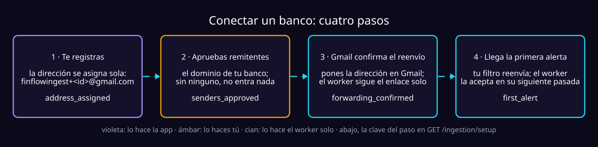

# Cómo un usuario conecta su banco (guía de backend)

El contrato de API para llevar a un usuario autenticado a tener su dirección de
reenvío y sus remitentes aprobados. Solo el lado del backend: las pantallas y
los textos son decisión del front.

- El porqué del modelo (una cuenta de Gmail compartida, un `+alias` por
  usuario, nada de OAuth): [overview.md](overview.md#el-modelo-de-entrada).
- Configurar esa cuenta como operador:
  [running.md](running.md#4-configurar-la-cuenta-de-ingesta).



Sin remitentes aprobados la dirección existe pero **no acepta nada**: el valor
seguro por defecto, nunca «aceptarlo todo mientras tanto».

## 1. Registrarse asigna la dirección

```http
POST /identity/register
Content-Type: application/json

{
  "email": "yo@example.com",
  "password": "una frase larga de verdad",
  "allowed_domains": [],
  "allowed_addresses": []
}
```

Los remitentes son opcionales aquí. La respuesta trae el token, no la
dirección: se pide en el paso siguiente. La dirección es **una función pura
del `user_id`**: no la elige el usuario, no la manda el cliente y no cambia
nunca.

## 2. Ver la dirección

```http
GET /identity/inbox
Authorization: Bearer <token>
```

```json
{
  "address": "finflowingest+8f3c1a2b9e7d4f0a8b6c5d4e3f2a1b0c@gmail.com",
  "allowed_domains": [],
  "allowed_addresses": []
}
```

## 3. Aprobar remitentes

```http
PATCH /identity/inbox
Authorization: Bearer <token>
Content-Type: application/json

{
  "allowed_domains": ["an.notificacionesbancolombia.com", "lulobank.com"],
  "allowed_addresses": []
}
```

> [!IMPORTANT]
> **Reemplaza la lista completa**, no la extiende: mandar `allowed_domains`
> vacío borra los dominios ya aprobados. Responde lo mismo que
> `GET /identity/inbox`, ya actualizado.

Los dominios de los bancos con plantilla propia:

| Banco | Dominios | Ojo |
| :--- | :--- | :--- |
| **Bancolombia** | `an.notificacionesbancolombia.com`, `notificacionesbancolombia.com`, `ayn.notificacionesbancolombia.com`, `bancolombia.com.co` | Manda desde varios. El último es el de las transferencias entre cuentas propias: sin él, esas alertas se descartan. |
| **Lulo bank** | `lulobank.com` | Es el del `From`. Sus `Message-ID` salen de `email.amazonses.com`, que comparten todos los clientes de SES: aprobarlo sería aprobarlos a todos. |
| **Cualquier otro** | Su dominio | Funciona igual, pero lo lee el modelo en vez de una plantilla. |

## 4. El usuario configura el reenvío en Gmail

Esto lo hace él, no la API:

1. **Configuración** (⚙️) → **Ver toda la configuración** → **Reenvío y
   POP/IMAP** → **Agregar una dirección de reenvío** → la del paso 2.
2. Gmail manda una confirmación **a esa dirección**, y el `ingest worker` la
   sigue solo en su siguiente pasada. No hay que hacer nada más.
3. Ya verificada, un **filtro** que reenvíe a esa dirección. En el campo
   **De** va `gmail_filter`, listo para pegar (lo da el paso 5), por ejemplo
   `@an.notificacionesbancolombia.com OR @lulobank.com`.

Desde ahí cada alerta nueva se copia sola y el worker la recoge en su siguiente
pasada: **cada minuto en producción y cada cinco en development**
(`IngestScheduleExpression`), y en local cada
`INGESTION_INGEST_POLL_INTERVAL_SECONDS` (60 por defecto).

### Cómo se confirma el reenvío

Cada `+alias` es una dirección distinta para Gmail, así que la confirmación es
**una por usuario**. Antes el operador tenía que buscar cada enlace en el buzón
compartido; ahora lo sigue el worker:

| Lo que llega | Lo que hace | En el log |
| :--- | :--- | :--- |
| Confirmación para un alias **registrado** | Sigue el enlace y envía el formulario de Google (es un `POST`, no abrir el enlace). Marca `forwarding_confirmed_at`. | `confirmations=1` |
| Confirmación para un alias que **no existe** | No la pide nunca: enrutaría el correo de un tercero al único buzón que se lee. | `unclaimed_confirmations` |
| Enlace vencido o ya usado | Google lo rechaza y el reenvío **no** quedó activo. | `refused_confirmations=1` |

> [!NOTE]
> El éxito es el estado HTTP de ese `POST`: una página de error servida con
> `200` no se distingue. Si el log dice `confirmations=1` y Gmail no muestra el
> reenvío activo, hay que rehacer el paso de agregar la dirección.

## 5. Saber en qué paso va el usuario

```http
GET /ingestion/setup
Authorization: Bearer <token>
```

```json
{
  "address": "finflowingest+8f3c1a2b9e7d4f0a8b6c5d4e3f2a1b0c@gmail.com",
  "steps": [
    { "key": "address_assigned",     "done": true,  "at": null },
    { "key": "senders_approved",     "done": true,  "at": null },
    { "key": "forwarding_confirmed", "done": true,  "at": 1756400000 },
    { "key": "first_alert",          "done": false, "at": null }
  ],
  "current": "first_alert",
  "ready": false,
  "unapproved_senders": [],
  "gmail_filter": "@an.notificacionesbancolombia.com OR @lulobank.com",
  "gmail_filter_terms": ["@an.notificacionesbancolombia.com", "@lulobank.com"]
}
```

Existe porque **dos de los cuatro pasos pasan donde el usuario no ve nada**: la
confirmación llega a un buzón que solo lee el despliegue, y la primera alerta la
recoge un worker.

| Campo | Qué significa |
| :--- | :--- |
| `steps` | Booleanos **independientes**, no una cadena: mucha gente configura el reenvío antes de aprobar a nadie. `at` es nulo en los dos pasos que son estados y en los que faltan. |
| `current` | El primer paso que falta, o `null` si no queda ninguno. |
| `ready` | Que los gastos **están entrando solos ahora**: una alerta aceptada y algún remitente aprobado. No es «todo en verde»: quien reenvía a mano está conectado y nunca tendrá confirmación. |
| `unapproved_senders` | Quién llega y se descarta por no estar aprobado: el único fallo que en pantalla se ve igual a «no llega nada». Se recalcula contra la lista actual, y queda vacío con `ready`. |
| `gmail_filter` | El texto del campo **De** de Gmail que reenvía exactamente los remitentes aprobados: `@dominio` por dominio, la dirección tal cual. Vacío si no hay ninguno. |
| `gmail_filter_terms` | Lo mismo, un término por aprobación, para saber a qué filtro hecho antes le falta alguno. |

Detalles de cómo se calcula:

- **Nada es progreso guardado.** No hay endpoint para avanzar un paso: todo se
  deriva del inbox en cada llamada, así que otro navegador ve lo mismo.
- **Las dos marcas** (`forwarding_confirmed_at`, `first_accepted_at`) se
  escriben una vez, con escrituras condicionales que no tocan el resto: el
  worker las pone mientras el usuario puede estar editando sus remitentes.
- **Una cuenta anterior a esas marcas se rellena sola** la primera vez que pide
  este endpoint, si encuentra correo aceptado. Es la única lectura que escribe,
  y ocurre una vez por cuenta.
- **El inbox se busca por dirección**, no por el índice `by_user`, que es de
  consistencia eventual y justo después del registro podría decir que no hay
  inbox. El índice queda de respaldo para registros anteriores.

## Lo que hay que saber sobre este modelo

| | |
| :--- | :--- |
| **El reenvío automático conserva el remitente** | El `From` sigue siendo el del banco (no así el botón «Reenviar» a mano), y el filtro de remitentes funciona igual que con el original. |
| **Riesgo residual: SPF/DKIM** | Un correo reenviado casi siempre falla SPF/DKIM. Quien adivinara la dirección de un usuario (sale de un UUID completo) *y* la exacta de su banco podría pasar el filtro sin pasar por el banco, y también sumarle strikes; un operador lo reactiva con `just model-access-prod <user_id> --reinstate`. No hay más verificación de autenticidad todavía. |
| **Confirmar un reenvío no concede nada** | Quien tenga la dirección puede escribirle directo: el reenvío es una ruta, no un permiso. Lo que decide es el filtro de remitentes. |
| **El enlace de confirmación va con correa corta** | Es entrada no confiable: esquema `https`, host exacto `mail-settings.google.com` y prefijo de ruta `vf-` (el de *cancelar* viene en el mismo correo). Se sigue **una** redirección, y solo si su host parseado sigue bajo `google.com`. |
| **Lo que ninguna plantilla lee, lo lee el modelo** | Con 20 lecturas por persona al día y strikes. Aprobar una dirección personal para reenviar a mano tiene costo: todo lo que llegue de ahí pasa por el modelo ([el tope](overview.md#el-tope-del-modelo)). |
| **Nunca se lee el buzón del usuario** | El worker solo abre la cuenta que el despliegue posee. |

## Errores

| Código | Cuándo | Cuerpo |
| :--- | :--- | :--- |
| `401` | Falta o es inválido el `Authorization: Bearer`. | — |
| `409` | `POST /identity/register` con un email ya registrado. | `{"detail": "An account with this email already exists"}` |
| `422` | Cuerpo inválido: contraseña débil, remitente sin `@`. | `{"detail": "..."}` |
| `404` | `/identity/inbox` o `/ingestion/setup` sin inbox. No debería pasar: el registro siempre lo crea. | `{"detail": "No inbox found for this account"}` |

El cliente nunca ve la App Password de la cuenta de ingesta (es configuración
del operador), ni maneja tokens de OAuth ni suscripciones que renovar.
