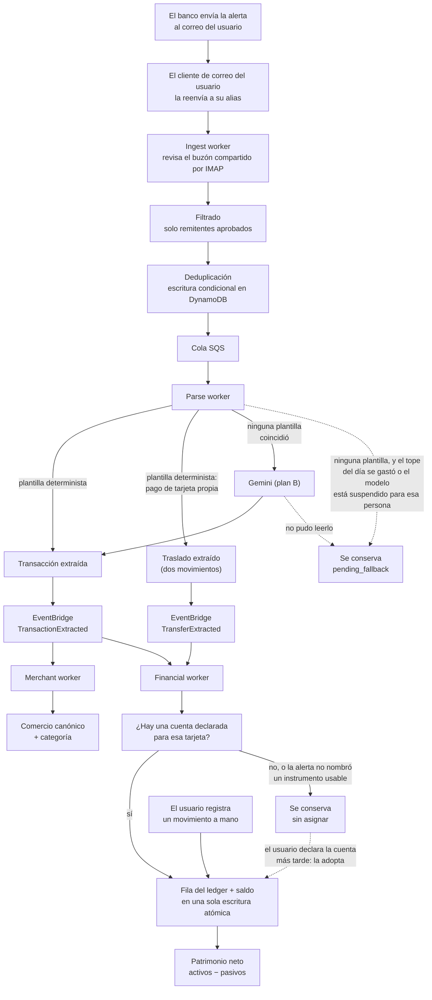

# Finflow — qué es y cómo funciona

Finflow es un backend de finanzas personales dirigido por eventos. Su objetivo
es que nadie tenga que registrar un gasto a mano: procesa los correos que el
banco ya envía, extrae cada movimiento, normaliza el comercio, actualiza saldos
y mantiene el patrimonio neto al día.

Se entrega como **aplicación web**, accesible desde el navegador del teléfono.
Deliberadamente no es una app nativa, así que no hay revisión de tienda de por
medio. Cuando en este repositorio se dice "la app" se habla de este software.

**Escala**: un despliegue privado para el autor y un puñado de amigos, cada uno
viendo solo sus propias finanzas. Eso justifica muchas decisiones — capa
gratuita de AWS, nada de sharding multi-tenant — pero el aislamiento por
usuario es estricto de todos modos.

## El modelo de entrada

Cada usuario **reenvía** las alertas de su banco a una dirección propia
(`algo+alias@gmail.com`) sobre **una sola cuenta de Gmail que la app misma
posee**. Un worker la revisa por IMAP; nunca se lee el buzón personal de
nadie, y no hay pantalla de consentimiento de por medio.

Esto no es un detalle de implementación, es la decisión central del producto:

- **El usuario configura el reenvío en su propio cliente de correo.** Es una
  regla de filtro ("todo lo que venga de mi banco, reenvíalo"), no algo que
  nosotros gestionamos por él.
- **La aprobación de remitentes sigue mandando.** Un correo reenviado solo se
  acepta si viene de un remitente que ese usuario aprobó explícitamente; una
  lista vacía significa *no aceptar nada*, nunca *aceptarlo todo*.
- **Nunca se lee un buzón ajeno.** La única bandeja que este sistema abre es
  la que él mismo controla, y solo para esto.

El contrato de API — cómo un usuario obtiene su dirección de reenvío y aprueba
remitentes — está en [email-forwarding.md](email-forwarding.md).

## El flujo principal



Merchant y Financial escuchan el **mismo** evento y no se conocen entre sí:
uno decide quién es el comercio, el otro cuánto dinero se movió y de dónde.
`TransferExtracted` es la excepción y va solo a Financial: un pago a tu propia
tarjeta no tiene comercio detrás, y crear uno pondría tu tarjeta en tu lista
de tiendas.

Dos propiedades gobiernan toda la cadena:

**Primero lo determinista, siempre.** Una plantilla es barata, repetible y
auditable. El modelo de lenguaje solo se consulta cuando todas las plantillas
del banco fallaron, y lo que devuelve pasa por un esquema Pydantic y después
por los objetos de valor del dominio. Si algo no cuadra, el correo se conserva
sin parsear en vez de inventarse una transacción.

**La entrega es at-least-once.** Todo el sistema asume que el mismo mensaje
puede llegar dos veces: la identidad de una notificación se deriva del usuario
más el `Message-ID`, la deduplicación es una escritura condicional en DynamoDB,
y ningún contador se incrementa sin haber reclamado antes el `event_id` del
evento que lo provocó.

## El tope del modelo

El modelo cuesta dinero en cada lectura y las plantillas no, así que el plan B
tiene un tope: **20 correos por persona y por día**. Las plantillas no tienen
límite: un usuario que pasó el tope sigue viendo entrar todo lo que venga de
un banco con plantilla.

| Caso | Cómo se cuenta |
|---|---|
| **Qué cuenta** | Cada correo que llega a Gemini porque ninguna plantilla lo reconoció. |
| **Qué no cuenta** | Lo que lee una plantilla, y un correo que el modelo no alcanzó a leer (caída, timeout): esa lectura se devuelve. |
| **Qué cuenta aunque no sirva** | Un correo que el modelo leyó y rechazó —una clave de un solo uso, una compra solo autorizada—: la lectura ya se pagó. |
| **El día** | El de Bogotá, de medianoche a medianoche, para todos. |
| **Reintentos** | El mismo correo entregado dos veces gasta **una** lectura: se cuenta por correo, no con un contador. |
| **Pasado el tope** | El correo queda en `pending_fallback` con `deferred_reason: daily_limit_reached`. No es un castigo ni avisa a nadie. |

**Un correo que pasó el tope no se vuelve a intentar.** Nada lo reencola al
día siguiente; el usuario lo ve en la lista de lo que llegó, marcado «Sin
leer: tope del día». Es un hueco conocido: si a alguien real le pasa, lo
siguiente es reintentarlo.

**Dónde se cuenta.** Una fila por persona y día, `MODEL_USAGE#<usuario>#<día>`,
en la tabla de notificaciones; no hay tabla aparte. Guarda los ids de los
correos que gastaron lectura, y una escritura condicional de DynamoDB es la
que niega la número 21. La fila se borra sola siete días después.

**Cambiar la cifra no exige desplegar.** El número vive en un parámetro de SSM
(`/finflow/<entorno>/llm-daily-calls-per-user`) que la función de parseo relee
como mucho cada cinco minutos, y solo cuando va a llamar al modelo:

```bash
just llm-limit-put production 25    # se aplica en menos de 5 minutos
just llm-limit-put production 0     # apaga el modelo para todos; las plantillas siguen
```

Leerlo no cuesta nada: es un parámetro estándar, y esas lecturas no se cobran.
Si SSM falla al releerlo, la función sigue con el último valor bueno. Pero si
el parámetro no existe, cada correo que necesite el modelo falla y acaba en
`parse-notifications-dlq`: por eso hay que crearlo antes del primer despliegue
de cada entorno (ver [deploy.md](deploy.md#el-tope-diario-del-modelo)). En
local es un número en `.env` (`LLM_DAILY_CALLS_PER_USER=20`) y no toca SSM.

**No hay tope global.** Un techo para toda la cuenta de Google haría que unos
usuarios gastaran el cupo de los otros. Es un riesgo de costo asumido a
propósito, y está en [decisions.md](decisions.md) («Limiting the model»).

### Los strikes

El tope diario frena el gasto; los strikes frenan el abuso. Cuando el modelo
lee un correo, también dice si lo escribió un banco. **Diez correos que no son
de un banco, llegados en menos de una hora**, son un strike para su dueño:

| Strike | Qué pasa |
|---|---|
| 1 | El modelo deja de leer sus correos durante 1 día |
| 2 | 3 días, y el aviso dice que es el último |
| 3 | Para siempre, hasta que un operador lo reactive |

- **Solo cuenta lo que el modelo juzga «no es de un banco».** Un correo de un
  banco que el modelo rechaza (una clave, un extracto, publicidad del banco) no
  cuenta: eso es banca normal. Si el modelo no dice nada o su respuesta no sirve,
  tampoco cuenta.
- **Se cuenta por cuándo llegó el correo**, no por cuándo se leyó: una cola
  atascada que se vacía de golpe no es una ráfaga.
- **Un strike caduca a los 90 días.** Pasado ese tiempo, la siguiente ráfaga
  vuelve a ser el strike 1.
- **Solo se suspende el modelo.** Las plantillas siguen leyendo, y lo que llega
  durante la suspensión y necesitaría el modelo se descarta sin leer:
  `pending_fallback` con `deferred_reason: model_suspended`, sin guardar el
  cuerpo.
- **Se avisa por todos lados**: un correo con el texto aprobado en
  [model-strikes-copy.md](model-strikes-copy.md), la campana, Telegram si lo
  tiene (aunque haya apagado los avisos), y un banner en la app mientras dure.
  Ingestion publica `ModelReadingSuspended` y Alerts lo entrega; el correo sale
  de la dirección que Identity tiene para esa persona.
- **Reactivar es a mano**, y borra los strikes:

  ```bash
  just model-access-prod <user_id>               # cómo está
  just model-access-prod <user_id> --reinstate   # reactivar
  ```

Por qué es así —y qué riesgos se aceptaron— está en
[decisions.md](decisions.md) («Limiting the model»).

## Los contextos acotados

Cada contexto es dueño de su modelo y no importa agregados, repositorios ni
servicios de dominio de otro. La única superficie de integración permitida es
un caso de uso publicado, llamado desde un adaptador en la capa de
infraestructura de quien llama — o, entre contextos asíncronos, un evento de
integración en EventBridge.

### Ingestion

El buzón de ingesta compartido, la asignación de direcciones de reenvío,
filtrado por remitente, deduplicación, parseo y extracción. Publica un único
evento hacia afuera: `TransactionExtracted`. Todo su ciclo de vida interno
(recibido, encolado, ignorado, fallido) se queda dentro.

La dirección de reenvío de un usuario (`finflowingest+<id>@gmail.com`) es una
función pura de su `user_id` — no hay nada que asignar ni que pueda colisionar.
El `ingest worker` revisa esa única cuenta por IMAP en un bucle con espera
entre pasadas (no hay equivalente a *long polling* en IMAP), y marca cada
correo como leído solo después de haberlo entregado de forma durable — un
reintento tras una caída vuelve a leerlo, nunca lo pierde.

### Merchant

Identidad canónica de comercios, alias y clasificación. Un **comercio** es un
padre; sus **hijos** son cada grafía que un banco ha usado para él. Solo se
llega al padre a través de los hijos.

El reconocimiento tiene cuatro niveles, en orden de cuánto asumen:

1. **Huella exacta** — la misma grafía ya vista. Ahí aterriza casi todo.
2. **Root key** — la grafía sin números de tienda, colas de dirección, formas
   jurídicas ni palabras genéricas. Mismo nombre módulo ruido, mismo padre.
3. **Submarca** — la raíz extiende a otra en frontera de token
   (`EXITO EXPRESS` bajo `EXITO`). Solo para compras, nunca para
   transferencias, que nombran personas.
4. **El modelo** — solo si todo lo anterior falló. Sabe lo que ningún
   normalizador puede: que `BANCOLOMBIA NEQUI` y `NEQUI` son una empresa.

El sesgo que decide cada empate: **agrupar mal etiqueta dinero y se esconde;
no agrupar cuesta un clic que se recuerda para siempre.** Por eso los niveles
3 y 4 marcan lo que proponen como *sugerencia* revisable, y una corrección del
usuario le gana a cualquier regla de forma permanente.

### Identity

Cuentas, credenciales y autenticación. También expone la bandeja (dirección de
reenvío + remitentes aprobados) de cada usuario autenticado, delegando en los
casos de uso de Ingestion a través de un adaptador propio — nunca calcula la
dirección ella misma.

### Financial

Cuentas, transacciones, saldos, deuda y patrimonio neto. Es lo que convierte
todo lo anterior en un número que alguien puede mirar.

**Las cuentas las declara su dueño, no se descubren.** Y Finflow funciona sin
ninguna: cada alerta se registra igual y el movimiento queda *sin asignar*.
Eso es una respuesta completa, no degradada — es exactamente lo que necesita
quien solo quiere ver qué entra y qué sale.

Una cuenta es lo que alguien añade cuando quiere algo más: el estado corriente
de una tarjeta o de una cuenta de ahorros sin abrir la app del banco. Al
declararla indica su tipo, su moneda, y opcionalmente el banco, el tipo de
instrumento y los últimos cuatro dígitos bajo los que llegan sus alertas. A
partir de ahí, todo lo que coincida con esa huella aterriza allí.

**Declarar una cuenta es retroactivo.** Las alertas que llegaron antes de que
existiera siguen en el ledger, sin asignar, y le pertenecen: se adoptan y el
saldo se recalcula reproduciéndolas. Una tarjeta declarada hoy abre con el
historial que ya tenía, no en cero.

**Lo que nunca llega por correo se registra a mano.** Un pago automático que
el banco no anuncia, efectivo, una transferencia que no generó alerta. Se
indica monto, contraparte, fecha y, si aplica, la cuenta. Y cualquier
movimiento —venga del banco o de una mano— se puede corregir después: la
primera corrección de una alerta guarda lo que el banco dijo, que es la única
forma de saber luego si el error estaba en la alerta o en la corrección.

Cada cuenta tiene un **tipo** (ahorros, corriente, efectivo, inversión,
tarjeta de crédito, préstamo, hipoteca) del que se deriva si es **activo o
pasivo**; nadie puede declarar que una hipoteca es un activo. El patrimonio neto es la suma de activos menos
la de pasivos, y es lo que hace que 1,2M en una tarjeta *reste*: lo que esa
cuenta guarda es deuda.

**La identidad de un movimiento sale de su contenido, no del correo.** Un
banco puede anunciar una compra en dos mensajes, el mismo mensaje puede
parsearse dos veces, y SQS entrega al menos una vez: bajo las tres el dinero
se movió una sola vez. La clave se calcula sobre usuario + banco + instrumento
+ dirección + monto + hora + contraparte, y va hasheada para que ningún
importe ni contraparte quede en claro allí donde se registra un id.

**El ledger manda; el saldo es un total acumulado.** Nada en memoria decide si
un movimiento ya se vio —esa respuesta no sobrevive a un reinicio—: lo decide
una escritura condicional sobre la clave del movimiento. La fila del ledger y
el cambio de saldo salen en una única escritura atómica, así que un saldo no
puede moverse sin una fila detrás que lo explique, y el saldo se puede
recalcular reproduciendo las filas cuando se sospecha que derivó.

**Un movimiento que no encuentra cuenta se conserva sin asignar**, nunca se
adivina ni se descarta: la alerta no nombró instrumento, lo nombró sin los
últimos cuatro dígitos, o nombró uno que Financial no sabe leer. El dinero se
movió igual, y un registro que alguien puede colocar después vale más que un
fallo limpio. Es la misma filosofía que `pending_fallback` en Ingestion.

**Una cuenta se identifica por (banco, tipo de instrumento, últimos cuatro).**
Emparejar solo por banco y tipo fundiría todas las cuentas de ahorro de un
mismo banco en un saldo equivocado. Una misma cuenta real puede responder a
varias huellas —una cuenta corriente llega como tarjeta débito en las compras
y como número de cuenta en las transferencias—, pero enlazarlas es siempre
decisión del dueño: deducirlo sería adivinar sobre el dinero de alguien.

**Un correo puede ser dos movimientos.** Pagar la tarjeta desde una cuenta del
mismo banco llega en un solo aviso y mueve dos saldos: sale plata de la cuenta
y baja la deuda de la tarjeta, por el mismo monto. Registrarlo como un
movimiento está mal en las dos direcciones —cargado a la cuenta, la deuda
nunca baja; cargado a la tarjeta, un movimiento saliente *sube* lo que se
debe—, así que Ingestion lo publica como `TransferExtracted` y Financial
escribe las dos mitades, cada una con su propia identidad y su propio
enrutamiento. Ninguna cuenta como gasto ni como ingreso: el patrimonio no se
movió. Solo lo produce una plantilla determinista, que puede distinguir los
dos instrumentos sin adivinar; al modelo se le dice que rechace esos correos,
porque elegir a ojo cuál es el origen es exactamente cómo un saldo se mueve al
revés.

**Una autorización no es un movimiento, y se descarta antes de llegar aquí.**
Una retención de hotel y su cobro real son dos correos distintos con cuerpos
distintos, así que el sitio barato y seguro para dejar caer el primero es el
parser: nunca llega a ser un `TransactionExtracted` y Financial no lo ve. Las
plantillas deterministas solo reconocen hechos consumados —`Compraste`,
`Pagaste`, `Transferiste`, `Recibiste`— y al modelo se le dice explícitamente
que rechace cualquier cosa aprobada, retenida o en proceso. Conciliarlas
después habría exigido una heurística sobre montos y ventanas de tiempo para
deshacer algo que el texto original ya dice.

El contrato HTTP —declarar cuentas, listarlas, patrimonio neto, movimientos,
entrada manual y edición— está en la colección de
[Postman](postman/README.md), carpeta *Financial*.

## Decisiones que conviene conocer

**El dinero nunca es un float.** Es `Decimal` en el dominio y una *cadena* en
los payloads de integración: un float JSON pierde centavos antes de que
Financial llegue a verlos.

**Los eventos de integración se construyen campo por campo.** Un evento de
dominio solo llega a EventBridge si el traductor de su propio contexto lo mapea
explícitamente. Añadir un campo a un agregado nunca puede ensanchar en silencio
lo que otros contextos reciben.

**El contenido de un correo y la salida del modelo son datos no confiables.**
Ambos se validan en el borde y se vuelven a validar en el dominio.

**Un secreto nunca se escribe en código ni en un log.** En producción los
secretos viven en SSM Parameter Store y el fichero de entorno solo guarda una
referencia: `IDENTITY_JWT_SECRET=ssm:/finflow/production/jwt-secret`. Cualquier
otro valor se toma como el secreto mismo, que es lo que mantiene el desarrollo
local con valores planos; las contraseñas de usuario solo cruzan hacia el almacenamiento ya
hasheadas; y la app se niega a arrancar si falta un secreto obligatorio —
incluida la dirección de ingesta misma, sin la cual nadie podría registrarse.

**El webhook de notificaciones bancarias es una costura de pruebas**, no un
camino de producto. Está montado únicamente cuando `ENVIRONMENT=local`.

## Stack

Python 3.13 (fijado), FastAPI, Pydantic v2, uv como único gestor de
dependencias, `just` para las tareas del proyecto. En AWS: DynamoDB, SQS,
EventBridge. Autenticación con bcrypt y JWT. Gemini como plan B de extracción y
clasificación. El DevContainer de VS Code es el entorno de desarrollo canónico.

---

Para levantar y probar todo esto, ver [running.md](running.md). Para
construir un cliente encima, [frontend-integration.md](frontend-integration.md).
