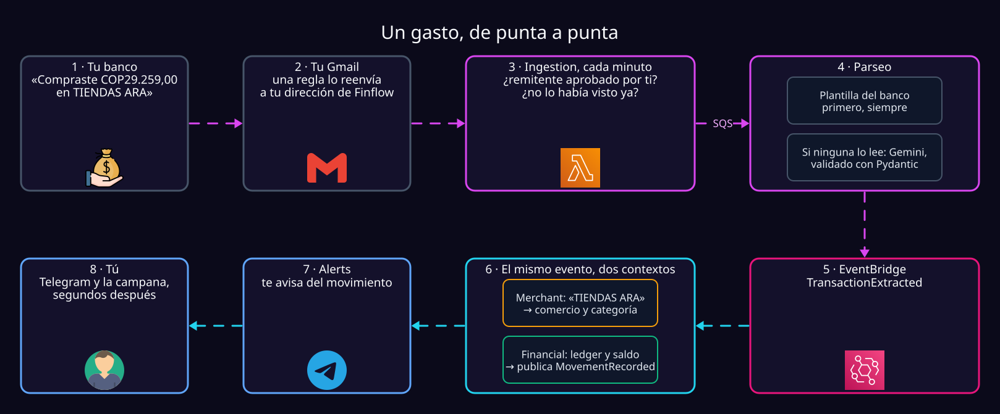
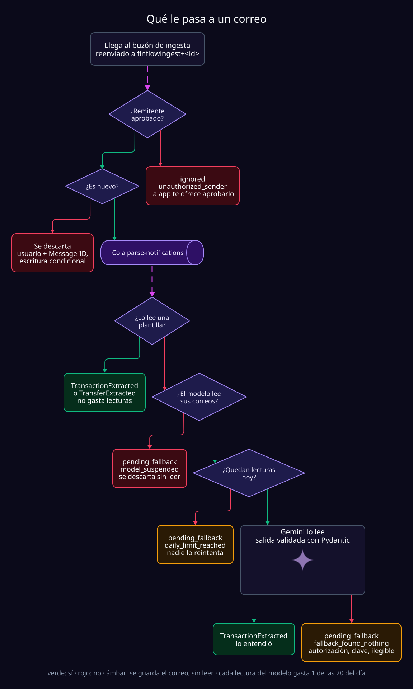
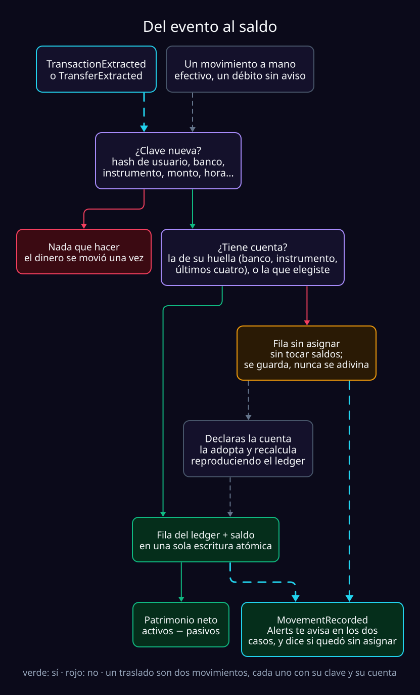
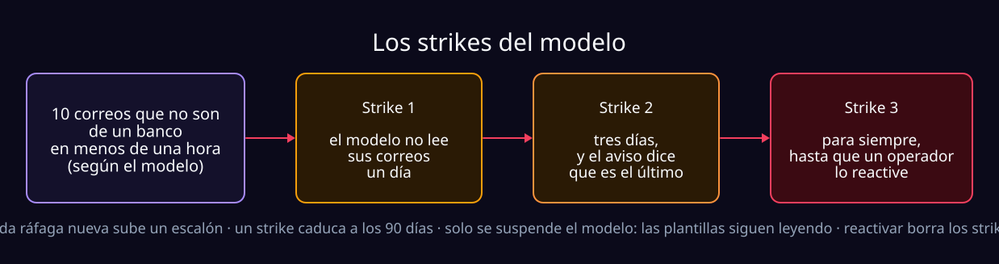
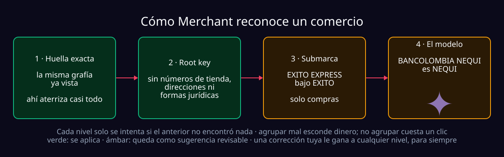

# Finflow — qué es y cómo funciona

Un sistema de finanzas personales **dirigido por eventos**: un backend
serverless en AWS y una app web encima. Lee los correos que el banco ya manda,
extrae cada movimiento, normaliza el comercio, mueve saldos, mantiene el
patrimonio al día y te avisa. Nadie registra un gasto a mano.

| | |
| :--- | :--- |
| **Entrega** | Una app web, desde el navegador del teléfono. No es nativa a propósito: no hay revisión de tienda. «La app» es este software. |
| **Escala** | Un despliegue privado para el autor y unos pocos amigos. Capa gratuita de AWS, sin *sharding*, pero con aislamiento estricto por usuario. |

## El modelo de entrada

Cada usuario **reenvía** las alertas de su banco a una dirección propia
(`finflowingest+<id>@gmail.com`) sobre **una sola cuenta de Gmail que la app
posee**, y un worker la lee por IMAP.

- **El reenvío lo configura el usuario**, con una regla en su propio correo.
- **Solo pasan los remitentes que él aprobó.** Una lista vacía es *no aceptar
  nada*, nunca *aceptarlo todo*.
- **Nunca se lee un buzón ajeno**, y no hay pantalla de consentimiento.

Cómo se obtiene la dirección y se aprueban remitentes:
[email-forwarding.md](email-forwarding.md).

## El flujo principal



Merchant y Financial escuchan el **mismo** evento sin conocerse: uno decide
quién es el comercio, el otro cuánto dinero se movió. `TransferExtracted` va
solo a Financial: un pago a tu propia tarjeta no tiene comercio detrás.

### Qué le pasa a un correo



Dos propiedades gobiernan la cadena:

- **Primero lo determinista, siempre.** Una plantilla es barata, repetible y
  auditable. Lo que devuelve el modelo pasa por un esquema Pydantic y por los
  objetos de valor del dominio: si algo no cuadra, el correo se conserva sin
  parsear en vez de inventar una transacción.
- **La entrega es at-least-once.** La identidad de un correo es usuario +
  `Message-ID`, la deduplicación es una escritura condicional en DynamoDB, y
  ningún contador sube sin reclamar antes el `event_id` que lo provocó.

### Del evento al saldo



## El tope del modelo

El modelo cuesta en cada lectura y las plantillas no: el plan B tiene un tope
de **20 correos por persona y por día**. Pasado el tope, lo que tenga
plantilla sigue entrando.

| Caso | Cómo se cuenta |
| :--- | :--- |
| **Cuenta** | Cada correo que llega a Gemini porque ninguna plantilla lo reconoció. |
| **No cuenta** | Lo que lee una plantilla, y lo que el modelo no alcanzó a leer (caída, timeout): esa lectura se devuelve. |
| **Cuenta aunque no sirva** | Lo que el modelo leyó y rechazó —una clave, una compra solo autorizada—: ya se pagó. |
| **El día** | El de Bogotá, de medianoche a medianoche, para todos. |
| **Reintentos** | El mismo correo dos veces gasta **una** lectura: se cuenta por correo, no con un contador. |
| **Pasado el tope** | `pending_fallback` con `deferred_reason: daily_limit_reached`. No castiga ni avisa, y **nadie lo reintenta** al día siguiente: el usuario lo ve como «Sin leer: tope del día». Hueco conocido. |

**Dónde vive.** Una fila por persona y día, `MODEL_USAGE#<usuario>#<día>`, en
la tabla de notificaciones, con los ids de los correos que gastaron lectura.
Una escritura condicional niega la número 21, y la fila se borra sola a los
siete días.

**Cambiarlo no exige desplegar.** La cifra vive en SSM
(`/finflow/<entorno>/llm-daily-calls-per-user`) y el parseo la relee como mucho
cada cinco minutos, solo cuando va a llamar al modelo:

```bash
just llm-limit-put production 25    # se aplica en menos de 5 minutos
just llm-limit-put production 0     # apaga el modelo para todos; las plantillas siguen
```

> [!WARNING]
> Si el parámetro no existe, cada correo que necesite el modelo falla y acaba
> en `parse-notifications-dlq`. Hay que crearlo antes del primer despliegue de
> cada entorno ([deploy.md](deploy.md#el-tope-diario-del-modelo)). Si SSM falla
> al releerlo, se sigue con el último valor bueno. En local es un número en
> `.env` (`LLM_DAILY_CALLS_PER_USER=20`).

**No hay tope global**: haría que unos usuarios gastaran el cupo de otros. Es
un riesgo de costo asumido ([decisions.md](decisions.md), «Limiting the
model»).

### Los strikes

El tope frena el gasto; los strikes frenan el abuso. Cuando el modelo lee un
correo también dice si lo escribió un banco.



- **Solo cuenta lo que el modelo juzga «no es de un banco».** Una clave o un
  extracto del banco que el modelo rechaza es banca normal, y una respuesta
  vacía o inválida tampoco cuenta.
- **Se cuenta por cuándo llegó el correo**, no por cuándo se leyó: una cola
  atascada que se vacía de golpe no es una ráfaga.
- **Durante la suspensión**, lo que necesitaría el modelo se descarta sin leer
  ni guardar (`deferred_reason: model_suspended`).
- **Se avisa por todos lados**: correo con el texto de
  [model-strikes-copy.md](model-strikes-copy.md), la campana, Telegram (aunque
  haya apagado los avisos) y un banner en la app. Ingestion publica
  `ModelReadingSuspended` y Alerts lo entrega.

```bash
just model-access-prod <user_id>               # cómo está
just model-access-prod <user_id> --reinstate   # reactivar; borra los strikes
```

## Los contextos acotados

Cada contexto es dueño de su modelo y no importa agregados, repositorios ni
servicios de otro. Se hablan por **eventos de integración** en EventBridge, o
llamando al **caso de uso publicado** del otro desde un adaptador propio.


### Ingestion

El buzón compartido, las direcciones de reenvío, el filtro de remitentes, la
deduplicación, el parseo, y el tope y los strikes del modelo. Su ciclo de vida
interno (recibido, encolado, ignorado, fallido) no sale de aquí.

- La dirección de reenvío es **una función pura del `user_id`**: no hay nada
  que asignar ni que pueda colisionar.
- **En AWS, una pasada por tick** de un schedule de EventBridge: cada minuto
  en producción, cada cinco en development (en local, un bucle con espera). Cada correo se marca leído **solo después**
  de entregarlo de forma durable: un reintento tras una caída lo vuelve a leer,
  nunca lo pierde.

### Merchant

Un **comercio** es un padre; sus **hijos** son cada grafía que un banco usó
para él. Solo se llega al padre a través de los hijos.



La submarca no se aplica a transferencias, que nombran personas.

### Identity

Cuentas, credenciales y autenticación. También expone la bandeja de cada
usuario (dirección de reenvío y remitentes aprobados), delegando en los casos
de uso de Ingestion: nunca calcula la dirección ella misma.

### Financial

Cuentas, movimientos, saldos, deuda y patrimonio neto. Lo que convierte todo
lo anterior en un número que alguien puede mirar.

| Regla | Qué significa |
| :--- | :--- |
| **Las cuentas se declaran, no se descubren** | Sin ninguna, cada alerta se registra igual *sin asignar*: es una respuesta completa, no degradada. Una cuenta se declara con tipo, moneda y, si quieres, banco, instrumento y últimos cuatro. |
| **Declarar es retroactivo** | Las alertas anteriores se adoptan y el saldo se recalcula: una tarjeta declarada hoy abre con su historial, no en cero. |
| **Una cuenta es (banco, instrumento, últimos cuatro)** | Solo banco y tipo fundiría todas las cuentas de ahorro de un banco. Una cuenta real puede tener varias huellas, pero enlazarlas lo decide su dueño. |
| **El tipo decide activo o pasivo** | Ahorros, corriente, efectivo, inversión, tarjeta, préstamo, hipoteca. Nadie declara una hipoteca como activo, y por eso 1,2M en una tarjeta *resta*. |
| **La identidad sale del contenido** | Usuario + banco + instrumento + dirección + monto + hora + contraparte, hasheado. Dos avisos, dos parseos o una reentrega de SQS: el dinero se movió una vez. |
| **El ledger manda** | Fila y saldo en una escritura atómica: ningún saldo se mueve sin una fila que lo explique, y se puede recalcular reproduciendo el ledger. |
| **Lo que no cuadra se conserva** | Sin cuenta, sin últimos cuatro o con un instrumento que no sabe leer: *sin asignar*, nunca adivinado. |
| **Un correo puede ser dos movimientos** | Pagar la tarjeta desde una cuenta del mismo banco: `TransferExtracted`, dos mitades, ninguna es gasto ni ingreso. Solo lo produce una plantilla; al modelo se le dice que rechace esos correos. |
| **Una autorización no es un movimiento** | La descarta el parser: las plantillas solo reconocen hechos consumados (`Compraste`, `Pagaste`, `Transferiste`, `Recibiste`) y al modelo se le dice que rechace lo aprobado, retenido o en proceso. |
| **Lo que no llega por correo se escribe a mano** | Efectivo, un débito sin aviso. Cualquier movimiento se corrige después, y la primera corrección de una alerta guarda lo que dijo el banco. |
| **Créditos e inversiones se calculan solos** | Cada corte de un crédito registra intereses y seguros con nombre. Préstamos e hipotecas se *vigilan* pero no suman al patrimonio; un CDT acumula su rendimiento y un fondo se valora a mano. |

Y tres cosas que **no mueven ningún saldo** por sí solas:

| | |
| :--- | :--- |
| **Facturas** | Un cobro que sabes que viene. Confirmarlo sí escribe, con identidad de factura + periodo: confirmar dos veces es un cobro. Antes de cobrar sola, mira si el banco ya avisó. Un detector propone las que se repiten, pero nunca declara ni cobra. |
| **El plan del mes** | Cuánto esperas que entre y cuánto guardar. De ahí sale el disponible: lo declarado, menos lo gastado y lo que las facturas aún deben. |
| **Presupuestos** | Techos sobre el mes, una categoría o varias. Informan, no bloquean, y pueden solaparse. |

El contrato HTTP está en [frontend-integration.md](frontend-integration.md), y
los requests en la carpeta *Financial* de [Postman](postman/README.md).

### Alerts

Todo lo que se le dice al usuario: Telegram segundos después de que se mueve
plata, la campana en la app (con o sin Telegram), el resumen del lunes y los
avisos de cuenta, que además van por correo. No publica nada. **Pregunta antes
de mandar y anota después**: una caída a mitad repite un mensaje en vez de
tragarse un aviso. Detalle en [alerts.md](alerts.md).

## Decisiones que conviene conocer

| Decisión | Por qué |
| :--- | :--- |
| **El dinero nunca es un float** | `Decimal` en el dominio y *string* en los eventos: un float JSON pierde centavos. |
| **Los eventos se arman campo por campo** | Solo llega a EventBridge lo que el traductor de cada contexto mapea: un campo nuevo en un agregado nunca ensancha en silencio lo que otros reciben. |
| **El correo y el modelo son datos no confiables** | Se validan en el borde y otra vez en el dominio. |
| **Ningún secreto en código ni en logs** | En producción viven en SSM y el `.env` guarda una referencia (`IDENTITY_JWT_SECRET=ssm:/finflow/production/jwt-secret`); cualquier otro valor es el secreto mismo, para el desarrollo local. Las contraseñas solo se guardan hasheadas, y la app no arranca si falta un secreto obligatorio, incluida la dirección de ingesta. |
| **El webhook bancario es una costura de pruebas** | Solo se monta con `ENVIRONMENT=local`; en producción nada lo llama. |

## Stack

| Capa | |
| :--- | :--- |
| **Backend** | Python 3.13 (fijado), FastAPI, Pydantic v2, uv, `just` |
| **AWS** | Siete funciones Lambda con SAM, DynamoDB, SQS con sus DLQ, EventBridge, SSM Parameter Store |
| **Seguridad** | bcrypt y JWT |
| **Modelo** | Gemini, solo como plan B de extracción y clasificación |
| **Frontend** | React + TypeScript con Vite, publicado en Cloudflare Pages |
| **Entorno** | DevContainer de VS Code |

---

Para levantarlo: [running.md](running.md). Para construir un cliente encima:
[frontend-integration.md](frontend-integration.md).
