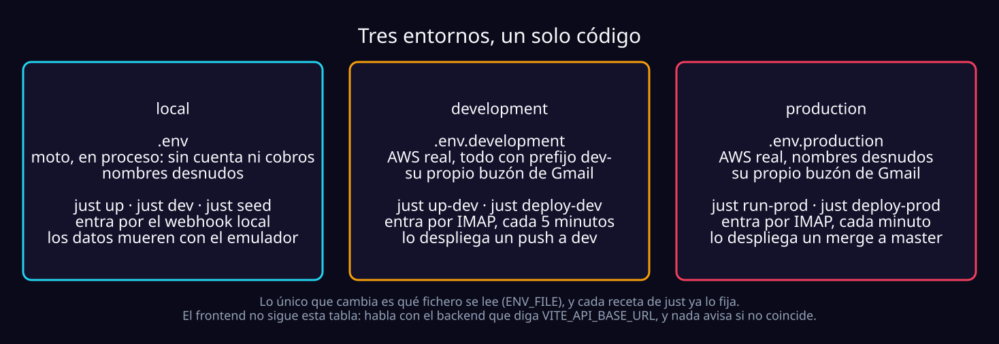

# Levantar y operar Finflow

Arrancar el sistema en los tres entornos, mirarlo y comprobar que cuadra.
**Desplegarlo es otra guía**: [deploy.md](deploy.md). Todo se ejecuta dentro
del DevContainer, en `/workspaces/finflow_v2`, y `just --list` es la fuente de
verdad de las tareas.

| Para | Ver |
| :--- | :--- |
| Poner el sistema en AWS y publicar el frontend | [deploy.md](deploy.md) |
| Qué hace el sistema y por qué | [overview.md](overview.md) |
| Qué endpoints hay y en qué orden se llaman | [frontend-integration.md](frontend-integration.md) |
| Probar la API a mano, sin `curl` | [postman/](postman/README.md) |
| Cómo un usuario conecta su banco | [email-forwarding.md](email-forwarding.md) |
| Trabajar dentro del frontend | [../frontend/README.md](../frontend/README.md) |

## Empezar: dos comandos

```bash
cp .env.example .env       # y edita dos valores: ver "Configurar .env"
just up                    # emulador, recursos, datos demo y los procesos
```

La API queda en <http://localhost:8000/docs>. El resto de la guía explica cada
paso y los otros dos entornos.

## Los tres entornos



- **Por qué tres y no dos.** DynamoDB on-demand cobra por petición, así que
  probar contra producción para no pagar dos veces es justo lo que no hay que
  hacer. `development` es una cuenta real con **todo prefijado `dev-`**: no
  puede escribir en las tablas de producción ni *consumir* sus mensajes (peor:
  el mensaje se borraría antes de que producción lo leyera). El prefijo lo
  aplica el código a partir de `ENVIRONMENT=development`.
- **Hoy los dos perfiles resuelven a la misma cuenta de AWS**: la separación
  real es el prefijo, no la cuenta.
  `aws sts get-caller-identity --profile finflow-dev --query '[Account,Arn]' --output text`
- **Los `.env*.example` están en git**, los `.env*` reales no. El `.example`
  es la plantilla comentada: si no sabes qué es una variable, lo dice el
  comentario de encima.
- **Lo desplegado no lee estos ficheros**: son siete Lambda configuradas en
  `infra/template.yaml` ([deploy.md](deploy.md)).

## Local

Corre contra **moto**, un emulador de AWS en proceso: sin Docker aparte, sin
credenciales reales y sin cobros.



### 1. Configurar `.env`

```bash
cp .env.example .env
```

Solo hay que tocar dos valores; el resto ya sirve para local, incluidas las
URLs de cola (el id de cuenta de moto es siempre `123456789012`).

| Variable | Por qué es obligatoria |
| :--- | :--- |
| `IDENTITY_JWT_SECRET` | Sin ella la API **no arranca**: firmar con un valor conocido es peor que no arrancar. `uv run python -c "import secrets; print(secrets.token_hex(32))"` |
| `INGESTION_INGEST_MAILBOX_ADDRESS` | Cualquier dirección con forma de correo. Cada registro deriva de ella la dirección de reenvío, así que sin ella nadie podría crearse una cuenta. |

> [!WARNING]
> **El buzón es lo único que el prefijo `dev-` no separa.** El
> `ingest worker` marca `\Seen` lo que lee, así que uno local o de dev sobre el
> buzón de producción **se come su correo**. Para correr `just ingest-worker`
> fuera de producción, usa otra cuenta de Gmail. Si no, deja
> `INGESTION_INGEST_MAILBOX_APP_PASSWORD` vacío: la API arranca igual y el
> worker se niega a arrancar, que es lo que quieres.

**El correo de Identity no hace falta en local.** Con
`IDENTITY_MAIL_FROM_ADDRESS` vacío y `ENVIRONMENT=local`, el código de
verificación y el enlace de restablecimiento van al log, y
`POST /identity/verification/request` además devuelve el código. Fuera de
local, un buzón sin configurar impide arrancar, en vez de publicar códigos
vivos en CloudWatch.

| Opcional | Qué hace |
| :--- | :--- |
| `LLM_API_KEY` | El plan B ([aistudio.google.com/apikey](https://aistudio.google.com/apikey)). Sin ella, lo que ninguna plantilla reconoce se guarda sin leer, y los comercios se agrupan solo con reglas. |
| `LLM_DAILY_CALLS_PER_USER` | El [tope del modelo](overview.md#el-tope-del-modelo), `20` si no está. En local es un número; desplegado, una referencia `ssm:`. |
| `API_CORS_ORIGINS` | Ya trae `http://localhost:5173,http://localhost:3000`. Vacío es ninguno, lo correcto si el frontend se sirve desde el mismo origen ([CORS](frontend-integration.md#cors-qué-origen-puede-llamar)). |

### 2. Infraestructura

```bash
just aws-init     # arranca moto y crea todo; idempotente
just aws-status   # qué existe ahora mismo
just aws-down     # lo para
```

Crea **ocho tablas** (`bank_notifications`, `user_inboxes`, `users`,
`credential_challenges`, `throttle`, `merchants`, `financial`,
`alert_channels`), **cuatro colas de trabajo con su DLQ** (`parse-notifications`,
`merchant-events`, `financial-events`, `alerts-events`), la cola espía
`integration-events`, el bus `finflow` y las reglas que lo conectan.

### 2.b Registrarse en local, con el código

Tres llamadas: pedir el código, canjearlo y crear la cuenta. En local el código
vuelve en la respuesta:

```bash
curl -s localhost:8000/identity/verification/request \
  -H 'content-type: application/json' -d '{"email":"yo@finflow.local"}'
# → {"expires_in_minutes":15,"code":"053471"}

curl -s localhost:8000/identity/verification/confirm \
  -H 'content-type: application/json' \
  -d '{"email":"yo@finflow.local","code":"053471"}'
# → {"verification_token":"…","expires_at":…}

curl -s localhost:8000/identity/register \
  -H 'content-type: application/json' \
  -d '{"email":"yo@finflow.local","password":"una frase larga de verdad",
       "verification_token":"…"}'
```

`just seed` y `just verify` no pasan por ahí: escriben el ticket en la tabla y
lo gastan en el endpoint real
(`identity/presentation/cli/verification_tickets.py`). Es el camino del
operador, no una puerta trasera: necesita escribir en DynamoDB y no está
expuesto por HTTP.

### 3. Datos de prueba

moto guarda todo **en memoria**: al pararse (`just aws-down`, un reinicio) se
va todo. En vez de hacer duradero el dato, `just seed` lo hace barato de
recrear: recorre la cadena entera dentro de su propio proceso (no necesita la
API ni los workers levantados), y repetirlo deja los mismos saldos.

```bash
just seed                  # la cuenta demo
just seed --with-llm       # deja el modelo conectado
just seed --email otra@finflow.local --password '…'   # un segundo usuario, para probar aislamiento
```

| Deja | |
| :--- | :--- |
| **La cuenta** | `demo@finflow.local` / `una frase larga de verdad`. El token sale al final, listo para Postman. |
| **Correo ya conectado** | Los cuatro pasos de `GET /ingestion/setup` en verde y `ready: true`, aprobados los dominios de **Bancolombia y Lulo**. |
| **12 alertas** | De los dos bancos, todas de las que lee una plantilla: sembrar no gasta modelo ni necesita red (por eso los workers avisan `no model configured`). |
| **4 cuentas** | Tarjeta Bancolombia, Ahorros Bancolombia, Ahorros Lulo y Efectivo, declaradas **después** de las alertas: la adopción retroactiva queda ejercitada. |
| **31 movimientos** | Ninguno sin asignar: la nómina llega sin últimos cuatro y el seed la asigna a mano. Incluye compras, ingresos, efectivo, una transferencia a un tercero y **dos traslados** (el pago de la tarjeta desde ahorros llega en un solo correo y se guarda como dos mitades). |
| **Facturas** | 6 declaradas, con una serie de cobros previos y uno del mes ya confirmado. |
| **Comercios y presupuestos** | 15 comercios (4 en revisión) y 4 presupuestos sobre el mes en curso. |

El paso `forwarding_confirmed` es el único que en local **no puede pasar
solo**: lo marca el `ingest worker` al seguir el correo de Google, y ninguna
Gmail reenvía al emulador. El seed lo escribe en el repositorio de bandejas
—no hay endpoint para eso, ni debe haberlo: es un hecho verificado, no algo que
un cliente pueda afirmar— y se niega a correr fuera de `ENVIRONMENT=local`.

### 4. Los seis procesos

La API y cinco workers. `just up` arranca todos menos uno, en una terminal:

```bash
just up                    # moto + recursos + seed + API + parse, merchant, financial y alerts
just up --with-ingest      # también el ingest-worker
just up --api-port 8001    # para tener local y development a la vez
```

Cada línea va etiquetada con su servicio, y un Ctrl+C los baja todos (hasta 25
s: los workers terminan el long poll en vez de tirar el mensaje). O cada uno en
su terminal:

| Proceso | Hace | Receta |
| :--- | :--- | :--- |
| API | <http://localhost:8000>, con recarga | `just dev` |
| ingest | IMAP → filtro de remitentes → SQS | `just ingest-worker` |
| parse | SQS → plantilla → modelo → EventBridge | `just parse-worker` |
| merchant | EventBridge → comercios canónicos | `just merchant-worker` |
| financial | EventBridge → ledger y saldos | `just financial-worker` |
| alerts | EventBridge → Telegram, la campana y los avisos de cuenta | `just alerts-worker` |

- **`just up` no arranca el `ingest-worker`**: el buzón es el mismo en todos lados
  y un run local contra un emulador en memoria se comería el correo de
  development sin que nada lo reporte. En local la entrada es el webhook.
- **`merchant` y `financial` escuchan el mismo evento** en colas distintas:
  puedes correr solo el que te interese. `alerts` escucha lo que publica
  Financial y, de Ingestion, solo la suspensión del modelo.
- **Sin `ALERTS_TELEGRAM_BOT_TOKEN`, `alerts` escribe el mensaje en vez de
  mandarlo**: ves el texto exacto ([probarlo](alerts.md#probarlo-en-local)).

> [!NOTE]
> En local se monta además `POST /ingestion/bank-notifications`, un webhook sin
> autenticar que acepta un correo entero sin pasar por ningún buzón. Es una
> costura de pruebas y **no existe fuera de `ENVIRONMENT=local`**. El recorrido
> request a request está en
> [frontend-integration.md](frontend-integration.md#guion-de-prueba-de-punta-a-punta).

<details>
<summary><b>La API escucha en <code>0.0.0.0</code>, y por qué</b></summary>
<br/>

Dentro de un DevContainer, `127.0.0.1` es una interfaz distinta de aquella a la
que Docker entrega el puerto publicado: un bind al loopback responde a `curl`
desde dentro y no a <http://localhost:8000/docs> desde el host. Se reconoce con
`ss -ltn` (`127.0.0.1:8000` en vez de `0.0.0.0:8000`). Fue un flag que se
olvidaba, y por eso acabó siendo el default; `just up --api-host 127.0.0.1`
vuelve a lo de antes. `just dev`, `run-dev` y `run-prod` también bindean
`0.0.0.0`.

Lo que decide quién llega desde fuera de la máquina es el *publish* de Docker
en `.devcontainer/devcontainer.json`. Si te preocupa la red local —`just up-dev`
habla con recursos reales—, estrecha ese mapeo a `127.0.0.1:8000:8000`.

</details>

### 5. Mirar qué está pasando

```bash
just inspect     # bandejas, notificaciones y profundidad de las colas
just events      # eventos que llegaron al bus (--follow para seguir)
just aws-status  # tablas, colas y buses que existen

just model-access <user_id>               # el modelo: open, paused hasta…, o revoked
just model-access <user_id> --reinstate   # reactivar y borrar sus strikes (-dev / -prod contra AWS)
```

`just events` es la única forma de comprobar que un evento salió: publicar en
un bus sin regla **tiene éxito** y no entrega nada. `just inspect` mira todo el
despliegue sin autenticación; la vista de un usuario es
`GET /ingestion/notifications`.

En el log del `financial-worker`, la línea que importa es `outcome`:

| `outcome` | Qué pasó |
| :--- | :--- |
| `applied` | Cayó en una cuenta declarada y movió su saldo. |
| `unassigned` | Nadie declaró una cuenta para ese instrumento. Se guarda y se adopta cuando exista. Es lo esperado, no un fallo. |
| `duplicate` | Ya estaba en el ledger: ni fila ni saldo, por eso `account_id` viene vacío. |

Los `domain_event` del log **no registran monto, contraparte ni dígitos**:
juntos son una línea del historial de gastos de alguien.

### 6. Antes de dar por terminado un cambio

```bash
just prepare   # formato + lint + tipos + tests
just fix       # arregla formato y lint
```

## Development: AWS real, todo con prefijo `dev-`

`ENVIRONMENT=development` es todo el mecanismo: el prefijo se aplica en código.
Las ocho tablas, las colas y el bus llevan `dev-` delante (`dev-financial`,
`dev-parse-notifications`, `dev-finflow`); las reglas no, porque su nombre es
único por bus.

```bash
cp .env.development.example .env.development
aws configure --profile finflow-dev   # la de dev, no la de producción
# edita AWS_PROFILE, IDENTITY_JWT_SECRET e INGESTION_INGEST_MAILBOX_ADDRESS
just provision-dev          # crea los recursos dev-*, una sola vez
# pega en .env.development las cinco URLs de cola que imprime
just up-dev                 # los procesos desde tu máquina, en una terminal
```

Uno por uno: `just run-dev` y los cinco `*-worker-dev`. Para dejarlos en AWS
como Lambda: [deploy.md → Backend → development](deploy.md#backend--development).

| Regla | Por qué |
| :--- | :--- |
| **Aquí el `ingest-worker` sí arranca** | El correo entra por donde entra en producción. Pero no corras a la vez el lector local y el desplegado: se disputan el buzón. |
| **Hereda todas las restricciones de producción menos una** | Puede usar `AWS_ENDPOINT_URL`, para ensayar contra moto. `*` como origen CORS se rechaza y el webhook local no se monta. |
| **Sus secretos son suyos** | Bajo `/finflow/development/`; `just secret-put` deduce el entorno de la ruta ([deploy.md](deploy.md#4-los-secretos-en-parameter-store)). |
| **Su buzón también** | Cada stack desplegado tiene su Gmail, y por eso los dos leen a la vez ([deploy.md](deploy.md#cada-stack-tiene-su-propio-buzón)). Lo que nunca se comparte es una cuenta entre dos lectores. |

## Producción

Misma imagen y mismo código; cambian el fichero y las credenciales.
`AWS_ENDPOINT_URL` está **prohibido** con `ENVIRONMENT=production`: un endpoint
de emulador olvidado no puede desviar tráfico real.

### 1. Credenciales y ficheros

```bash
cp .env.production.example .env.production
aws configure --profile finflow-production
```

- **Ninguna clave de AWS va en el fichero**: en tu máquina salen del perfil, y
  desplegado del rol de la función.
- **Los secretos tampoco** (`IDENTITY_JWT_SECRET`, `IDENTITY_MAIL_APP_PASSWORD`,
  `INGESTION_INGEST_MAILBOX_APP_PASSWORD`, `LLM_API_KEY`,
  `ALERTS_TELEGRAM_BOT_TOKEN`, `ALERTS_TELEGRAM_WEBHOOK_SECRET`): van en SSM y
  el fichero guarda la referencia, `IDENTITY_JWT_SECRET=ssm:/finflow/production/jwt-secret`.
  Un valor que no empiece por `ssm:` es el secreto mismo; `grep ssm:
  .env.production` dice cuáles ya salieron. Se leen una vez por proceso:
  rotar exige reiniciar ([cómo](deploy.md#4-los-secretos-en-parameter-store)).

### 2. Los recursos

`just provision-prod` y las cinco URLs de cola que imprime en
`.env.production` ([pasos completos](deploy.md#backend--producción)).
`just aws-status .env.production` dice qué existe.

### 3. Correr producción desde tu máquina

Lo normal es que corra desplegada. Los procesos de siempre siguen sirviendo para
depurar contra datos reales o comprobar algo sin desplegar:

```bash
just run-prod              # uvicorn, sin recarga, puerto 8000
just ingest-worker-prod
just parse-worker-prod
just merchant-worker-prod
just financial-worker-prod
just alerts-worker-prod
```

> [!CAUTION]
> **No los corras a la vez que el despliegue**: el `ingest-worker` competiría
> con la función por el buzón, y los de cola por los mismos mensajes.

### 4. Configurar la cuenta de ingesta

Manual, una sola vez, y no depende de ningún usuario:

1. Una cuenta de Gmail dedicada (no la tuya).
2. Verificación en dos pasos.
3. Una **App Password** (Cuenta de Google → Seguridad → Verificación en dos
   pasos → Contraseñas de aplicaciones).
4. En `.env.production`:

   ```dotenv
   INGESTION_INGEST_MAILBOX_ADDRESS=tu-cuenta-de-ingesta@gmail.com
   INGESTION_INGEST_MAILBOX_APP_PASSWORD=ssm:/finflow/production/mailbox-app-password
   ```

Sin dirección la API no arranca (no hay modo degradado: cada registro deriva
de ella). Sin App Password la API arranca, pero el `ingest worker` no. Cómo
cada usuario conecta su banco: [email-forwarding.md](email-forwarding.md).

## El frontend

`frontend/` es una SPA estática (Vite, React y TypeScript). No lee `ENV_FILE`:
tiene **dos modos de Vite**, y a qué backend habla lo decide una sola variable,
**`VITE_API_BASE_URL`**.

| Comando | Modo | Lee | Para qué |
| :--- | :--- | :--- | :--- |
| `just web` | development | `frontend/.env.development` | Servidor con recarga en <http://localhost:5173> |
| `just web-build` | production | `frontend/.env.production` | Construye `dist/` |
| `just web-publish` | production | `frontend/.env.production`, **generado** | Construye y sube a Cloudflare Pages |

| Contra qué integrar | `VITE_API_BASE_URL` |
| :--- | :--- |
| Local (`just up` / `just dev`) | `http://localhost:8000` |
| Development desplegado | la `ApiUrl` de `just deploy-outputs-dev`, sin barra final |
| Producción desplegada | la `ApiUrl` de `just deploy-outputs-prod` |

```bash
cp frontend/.env.example frontend/.env.development   # trae localhost:8000
just web-install                                     # una vez
just web
```

`http://localhost:5173` está en el `CorsOrigins` de los dos entornos, así que
funciona contra cualquiera; otro puerto o dominio hay que añadirlo en
`infra/samconfig.toml` y volver a desplegar. **Todo lo que pongas en esos
ficheros viaja en el bundle**: nunca una clave.

### Lo que se rompe y no lo parece

| Síntoma | Qué pasa |
| :--- | :--- |
| **La interfaz pinta, pero nada funciona** | El HTML lo sirve Vite, no la API: el login se dibuja perfecto aunque la API no responda. Mira si el 8000 está arriba; son dos puertos y hay que publicar los dos. |
| **Levantaste un entorno y apuntas a otro** | `just dev` en el 8000 y `.env.development` con la URL de AWS conviven sin quejarse. El fichero está en `.gitignore`, así que no sale en un `git diff`: mira el dominio de las peticiones en la pestaña **Network**. |
| **`401` con la cuenta demo en un entorno desplegado** | `demo@finflow.local` solo existe en el emulador. Allí hay que registrarse una vez. |
| **Error de CORS que parece del cliente** | El origen no está en `API_CORS_ORIGINS`. Por eso `vite.config.ts` fija el 5173 con `strictPort`: un puerto que se mueve solo rompe CORS. |
| **La URL `Network` de Vite (`172.17.x.x`) no abre** | Es la red interna de Docker. Abre siempre `http://localhost:5173` ([frontend/README.md](../frontend/README.md)). |

### Verlo de verdad: `just shot`

En el DevContainer no hay navegador, así que una pantalla que solo compila
**nunca se ha visto**. `just shot` abre un Chromium sin cabeza sobre la app que
ya corre y escribe PNGs en `frontend/.screenshots/` (que git ignora).

```bash
just up && just web           # en dos terminales
just shot                     # las pantallas principales, tamaño teléfono
just shot /reportes --full    # una sola, la página entera
just shot /cuentas --desktop  # 1280x900 en vez de 390x844
```

- **No levanta nada**: si no hay nada en `localhost:5173` te dice qué arrancar.
- **Entra con la cuenta demo por el formulario de verdad**: si el login se
  rompe, falla ahí y no te da seis capturas de la pantalla de acceso.
- **Silencia el onboarding**; `--onboarding` lo deja para fotografiar la guía.
- Si Chromium se queja de una librería:
  `sudo $(command -v node) frontend/node_modules/playwright/cli.js install-deps chromium`,
  y añade a `.devcontainer/Dockerfile` lo que instale.

### El contrato entre las dos mitades

`docs/openapi.json` se genera desde los routers de Python, y de ahí salen los
tipos TypeScript:

```bash
just web-types    # regenera docs/openapi.json y src/api/schema.d.ts
just check-all    # prepare + openapi-check + web-check
```

Si no lo haces, `just openapi-check` falla: un endpoint que cambia rompe la
compilación del frontend en vez de una pantalla. Publicar está en
[deploy.md → Frontend](deploy.md#frontend--cloudflare-pages).

## DynamoDB: on-demand, no aprovisionado

Las ocho tablas corren en **`PAY_PER_REQUEST`** en los tres entornos.

| | |
| :--- | :--- |
| **Por qué no la capa gratuita** | `PROVISIONED` regala 25 unidades de lectura y 25 de escritura **compartidas en toda la cuenta**, y cada índice cuenta como una tabla: con cinco tablas y dos índices ya se gastaban 21. Cada índice nuevo obligaba a bajar capacidad, y tres unidades por tabla quedaban a un refresco de estrangularse. |
| **Qué cuesta** | A diez correos reenviados al día, del orden de **un céntimo al mes**: una factura inmedible a cambio de un techo que ya no condiciona el diseño. |
| **El techo** | `INGESTION_DYNAMODB_MAX_READ_UNITS` / `..._MAX_WRITE_UNITS` (25) estrangulan un bucle descontrolado en vez de facturarlo. Es un radio de explosión, no un presupuesto: el control de gasto es una alarma de facturación en la cuenta. |
| **Cambiar de modo funciona** | `INGESTION_DYNAMODB_BILLING_MODE=PROVISIONED` y volver a aprovisionar **mueve las tablas existentes** (mandan `..._READ_CAPACITY` / `..._WRITE_CAPACITY`). En los dos sentidos: un fichero con el modo viejo devuelve tablas vivas al modo viejo sin avisar. |

### Copias de seguridad

Las ocho tablas quedan con **point-in-time recovery**: cualquier segundo de los
últimos 35 días, en los tres entornos. Protege contra la forma normal en que se
pierden datos —borrar la tabla equivocada, un despliegue que corrompe saldos
unas horas— y es lo único de esta guía que **no se puede añadir después**.
Importa sobre todo por `financial`: el ledger del que se recalculan los saldos.

**Restaurar crea una tabla nueva**, nunca sobrescribe, así que puedes comparar
antes de decidir:

```bash
aws dynamodb restore-table-to-point-in-time \
  --profile finflow-production \
  --source-table-name financial \
  --target-table-name financial-restaurada \
  --restore-date-time 2026-09-03T14:32:00Z
```

Tarda de minutos a horas. Comprobada, apunta la app con
`FINANCIAL_ACCOUNTS_TABLE=financial-restaurada` y reinicia, o renómbrala. Cuesta
más o menos almacenar la tabla otra vez: céntimos.

## Comprobar que los datos cuadran

```bash
just verify                    # contra el emulador
just verify .env.development   # contra la cuenta dev
```

Recorre el flujo entero con **dos usuarios** —registro, remitentes, alertas,
los workers, cuentas declaradas a posteriori, movimientos a mano, renombrar un
comercio— y comprueba:

| Familia | Qué |
| :--- | :--- |
| **Integridad** | Cada saldo es igual a sus movimientos; patrimonio = activos − pasivos; un movimiento asignado está en una cuenta que responde a su instrumento; los buckets del resumen suman su total. |
| **Aislamiento** | Ninguno llega a lo del otro, ni leyendo ni escribiendo. Un id ajeno responde `404` y no `403`: un `403` ya confirmaría que existe. |

Sale con 1 si algo falla. Se **niega a correr con `ENVIRONMENT=production`**
(registra dos usuarios con una contraseña escrita en el repositorio):
`--yes-really-production` lo fuerza; `--keep-llm` deja el modelo conectado.

## Cuando algo falla

El sistema prefiere fallar ruidosamente al arrancar que degradarse en silencio:

| Mensaje | Qué hacer |
| :--- | :--- |
| `IDENTITY_JWT_SECRET is not set` | Genera y pega el secreto. Todo token sería falsificable. |
| `IDENTITY_MAIL_FROM_ADDRESS and IDENTITY_MAIL_APP_PASSWORD are not set` | Fuera de local, sin buzón nadie puede registrarse ni recuperar su cuenta. En local, déjalos vacíos: el código va al log. |
| `IDENTITY_PASSWORD_RESET_URL must be an absolute https:// URL` | Es la página del frontend del enlace, no una ruta de la API. Sin `https` el token viajaría a la vista. |
| `INGESTION_INGEST_MAILBOX_ADDRESS is not set` | Sin ella nadie puede registrarse. |
| `INGESTION_INGEST_MAILBOX_ADDRESS / ..._APP_PASSWORD are not set` (solo el `ingest worker`) | Configura la cuenta dedicada. |
| `INGESTION_PARSE_QUEUE_URL is not set` | Aprovisiona y pega la URL; si no, se aceptarían correos que nunca se leerían. |
| `MERCHANT_EVENTS_QUEUE_URL`, `FINANCIAL_EVENTS_QUEUE_URL` o `ALERTS_EVENTS_QUEUE_URL is not set` | Igual, para su worker: sin cola no hay nada que drenar. |
| `Could not read the secret at '/...' from Parameter Store` | La referencia `ssm:` apunta a algo que no existe o que el rol no puede leer. Nunca se degrada a vacío. |
| `AccessDeniedException` al aprovisionar | Faltan permisos; con PITR, también `dynamodb:DescribeContinuousBackups` y `dynamodb:UpdateContinuousBackups`. |
| `AWS_ENDPOINT_URL must be unset when ENVIRONMENT=production` | Fichero de entorno equivocado. |
| `Missing .env… — copy it from ….example` | La receta no encuentra su fichero. |
| `no model configured` (aviso) | Falta `LLM_API_KEY`. Todo sigue, sin plan B. |
| `Could not read the parameter at '/finflow/<entorno>/llm-daily-calls-per-user'` | El tope no existe en SSM o no es un número: `just llm-limit-put <entorno> 20`. Lo que falló entretanto está en `parse-notifications-dlq`. |
| `Expected a whole number from the configured value` | `LLM_DAILY_CALLS_PER_USER` no es un entero. El parse worker no arranca. |
| `could not refresh a tunable value; keeping the last one` (aviso) | SSM no respondió al releer el tope, o lo cambiaron por algo que no es un número. Sigue con el último bueno. |
| `InvalidParameterValueException: ... maximum visibility timeout` | El timeout de una función supera el de su cola. 120 s o menos. |
| `Resource of type 'AWS::Logs::LogGroup' ... already exists` | Un log group con ese nombre existe fuera del stack. Bórralo o renómbralo en la plantilla. |
| `ExpiredTokenException` en una función con horas de vida | Credenciales congeladas; comprueba que no haya un `AWS_PROFILE` en la plantilla. |
| La respuesta reporta fallos y los mensajes desaparecen igual | Falta `FunctionResponseTypes: [ReportBatchItemFailures]` en el enganche de esa cola. |

> [!TIP]
> **Si algo desaparece sin explicación, mira las colas `*-dlq`.** Un worker
> borra el mensaje al terminar bien, no al recogerlo; tras cinco intentos SQS
> aparta el que siempre falla. Eso convierte «desapareció dinero» en «hay 40
> mensajes en `parse-notifications-dlq`», y `just inspect` muestra ese número.
> Desplegado, cada DLQ tiene una alarma a `AlertEmail`; en local nadie la
> vigila.

Un mensaje que no cumple su esquema se borra: nunca va a cumplirlo. Uno que
quizá entienda un despliegue más nuevo (una moneda, una versión desconocida) se
deja y acaba en la DLQ, porque borrarlo destruiría un movimiento real.
